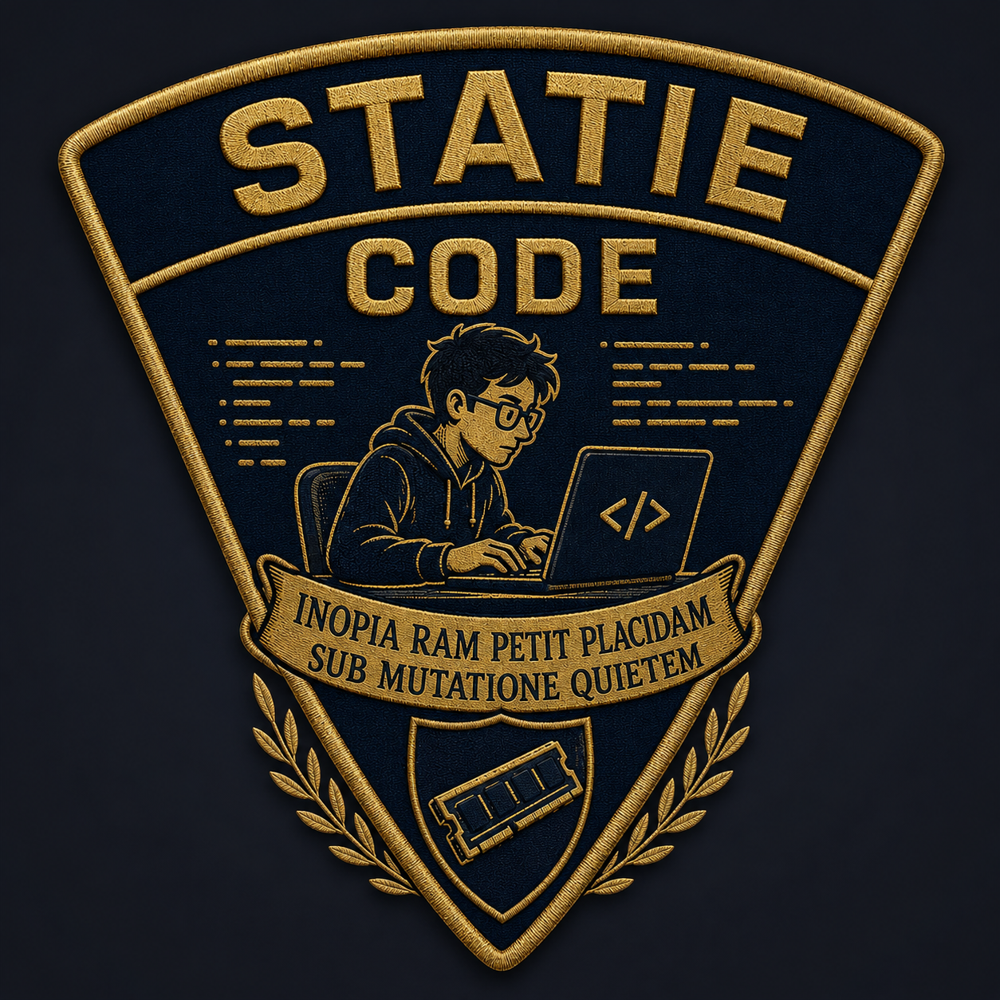

# statie



statie is a mutable-state, interactive coding harness for local LLMs, written
in Rust. It implements the SKILL.state architecture from
[*SKILL.state* (Badhe, Tiwari, Chung — arXiv:2608.26263, EMNLP 2026)](https://arxiv.org/abs/2608.26263),
adapted for an interactive terminal workflow instead of batch skill
execution.

The idea: instead of growing a transcript on every turn, the model gets one
bounded prompt per step — an immutable skill spec, the current structured
workspace state, the latest tool observation, and a little retrieval — and
answers with a single JSON patch to that state plus one action (call a tool,
ask the user, or finish). Its reasoning never re-enters the prompt. The full
history is persisted and searchable through a `recall` tool, but prompt size
stays flat whether the session is 5 steps or 500.

Everything about which model server to talk to, where state lives, and how
big the budgets are comes from a JSON config file, the way you'd configure
any other agentic coding harness. Nothing is hardcoded.

## Quick start

```sh
cargo install --path cli                 # installs `statie` into ~/.cargo/bin
statie config init --global              # writes ~/.config/statie/config.json
$EDITOR ~/.config/statie/config.json     # point model.base_url at your server
statie check                             # is the server reachable, is the model there?

cd ~/some/project
statie                                   # TUI, fresh session
statie "add a --json flag to the CLI"    # TUI, seeded with a first message
statie -p "add a --json flag to the CLI" # headless: run to completion, print, exit
statie -r                                # resume the session in ./.statie/
```

A working config for gemma4:26b on Ollama looks like this (the rest of the
keys take their defaults):

```json
{
  "model": {
    "backend": "ollama",
    "base_url": "http://192.168.1.222:11434",
    "model": "gemma4:26b",
    "num_ctx": 16384,
    "timeout_secs": 1200,
    "options": { "temperature": 0.3 }
  },
  "budget": { "total": 12000, "observation": 2000, "augmentation": 1000 }
}
```

`sandbox_root` defaults to the current directory, so run `statie` from the
project you want it to work on. Session state lives in `./.statie/`, which
writes its own `.gitignore`.

## Configuration

statie reads a single JSON config file. Resolution order, first hit wins:

1. `--config <path>`
2. `$STATIE_CONFIG`
3. `./.statie/config.json`
4. `$XDG_CONFIG_HOME/statie/config.json`, defaulting to
   `~/.config/statie/config.json` (a file in the platform config dir, e.g.
   `~/Library/Application Support/statie/config.json` on macOS, is honoured
   as a fallback)
5. built-in defaults (no file at all)

Every field has a default, so a partial file — even `{}` — is valid; an
unrecognized key (a typo like `"modle"`) is a hard error rather than being
silently ignored. `statie.example.json` at the repo root is the full default
config with every key spelled out; `statie config show` prints the config
statie would actually use and where it came from.

| Key | Type | Default | Meaning |
|---|---|---|---|
| `model.backend` | string | `"ollama"` | `"ollama"`, `"openai"`, or `"mock"`. `"openai"` talks to any OpenAI-compatible chat completions server (vLLM, llama.cpp server, LM Studio, ...). `"mock"` replays `model.mock_script` — used for tests and CI, never talks to the network. |
| `model.base_url` | string | `"http://localhost:11434"` | Base URL of the model server. Ollama default shown; for `"openai"` backend a typical value is `"http://localhost:8000/v1"`. |
| `model.model` | string | `"gemma4:26b"` | Model name/tag as the backend expects it. |
| `model.think` | bool | `true` | Ask Ollama for native `thinking` output (`"think": true` on `/api/chat`). Ignored by other backends. |
| `model.retries_on_5xx` | integer | `2` | How many times an Ollama call is retried after a 5xx or a dropped connection (the runner restarts itself after a crash) before the step parks. |
| `model.retry_delay_secs` | integer | `15` | Wait between those retries; cancellation aborts the wait. |
| `model.api_key` | string or null | `null` | Bearer token for `"openai"` backend. Falls back to `$STATIE_API_KEY` if unset. |
| `model.num_ctx` | integer | `32768` | Context window sent on every Ollama request. Pinned on purpose: Ollama reloads the model (and re-allocates its KV cache) whenever a request uses a different `num_ctx`, so keep this constant and match any other client of the same server. |
| `model.format` | string | `"json"` | Ollama `format` mode: `"schema"` (full JSON schema grammar), `"json"` (plain JSON mode) or `"none"`. Default is `json`. On Ollama 0.33 with gemma4 the first full-schema grammar degraded output (the model collapsed to `yield`/`done` while its reasoning said to call a tool); that schema was a `oneOf` over the action variants, and the action schema is now one flat object with a `type` enum, so `schema` is worth retrying. Every output is validated against the schema regardless. |
| `model.schema_constrained` | bool or null | `null` | Whether the backend enforces the schema; `null` derives it from `format` (Ollama) or is `true` (OpenAI-compatible). When false the schema is also pasted into the system prompt. |
| `model.options` | object | `{}` | Passed through verbatim: Ollama's `options` object, or merged into the OpenAI-compatible request body (e.g. vLLM's `guided_json`). |
| `model.timeout_secs` | integer | `600` | Per-request timeout. |
| `model.mock_script` | array of `{reasoning?, content, prompt_tokens?, completion_tokens?}` | `[]` | Scripted turns for `backend: "mock"`. The last turn repeats once the script is exhausted. `prompt_tokens`/`completion_tokens` (both must be set together) script that turn's server-reported `Usage`, standing in for what a real backend's `usage`/`prompt_eval_count` would report. |
| `budget.total` | integer | `24000` | Token budget for the whole prompt. |
| `budget.observation` | integer | `3000` | Cap on the latest tool-observation section (head/tail truncated beyond this). |
| `budget.augmentation` | integer | `2000` | Combined cap across all augmenters. |
| `budget.working_set` | integer | `6000` | Cap on the working-set section: recent calls plus the last few read windows, derived from the log each step (spec section 10). |
| `budget.notes` | integer | `400` | Cap on the harness-maintained `notes` section (see `maintainer`). Overridden by `maintainer.budget` when that section is present. |
| `retries` | integer | `3` | Rejected model outputs tolerated before the session parks with a failure, asking the user to intervene. |
| `store.kind` | string | `"sqlite"` | `"memory"` or `"sqlite"`. |
| `store.path` | path | `.statie/session.db` | SQLite database path, resolved relative to `sandbox_root`. |
| `session_log` | path | `.statie/session.jsonl` | Append-only JSONL session log (searchable via BM25), resolved relative to `sandbox_root`. |
| `sandbox_root` | path | `"."` | Root all tool file access and the repo augmenter are confined to. |
| `augmenters.repo_bm25.enabled` | bool | `true` | BM25 retrieval over source files under `sandbox_root`. |
| `augmenters.repo_bm25.budget` | integer | `1200` | Token budget for this augmenter. |
| `augmenters.session_log_bm25.enabled` | bool | `true` | BM25 retrieval over the session log (tool output, user messages, system events — never reasoning). |
| `augmenters.session_log_bm25.budget` | integer | `800` | Token budget for this augmenter. |
| `tools.shell_timeout_secs` | integer | `120` | Default timeout for the `shell` and `test` tools. |
| `tools.allow_shell` | bool | `true` | Whether the `shell` and `test` tools are registered at all. |
| `tools.max_output_bytes` | integer | `200000` | Per-tool output cap before truncation. |
| `working_set.max_windows` | integer | `4` | How many recent `read_file`/`search` outputs stay in the prompt verbatim (newest first; a window is dropped once its file is edited). `0` disables the section. |
| `working_set.recent_calls` | integer | `6` | How many recent steps get a one-line `tool args -> result` entry at the top of the working set. |
| `maintainer` | object or absent | absent | Context maintenance (spec section 9). When present, a second model call runs after every committed step and distils that step's reasoning into the harness-owned `notes` field before the reasoning is dropped; it may also propose `next` when the model decided on a mutating call but did not write it. Absent means no maintainer and no behaviour change. |
| `maintainer.model` | object | the top-level `model` | Same shape as `model`. A smaller model here buys back the extra call's latency; on one GPU the calls are serialized. |
| `maintainer.budget` | integer | `400` | Token cap on `notes`; the maintainer is told the cap and retried once if it overruns, then the previous notes are kept. |
| `maintainer.timeout_secs` | integer | `120` | Per-call timeout; a timeout keeps the previous notes and never blocks the step. |
| `maintainer.prompt_budget` | integer | `4000` | Cap on the maintainer's own prompt (previous notes, state, commitment, patch, action, reasoning, observation; the last two are head/tail truncated to fit). |
| `thinker` | object or absent | absent | The `think` tool's backend (spec section 10). When present, a `think {question}` call runs a second model call with thinking on and no output schema, handing it the calling step's own prompt plus the question, and returns its conclusion as the tool output and as the workspace's harness-owned `decision`. Absent means the tool answers "not configured" and nothing else changes. |
| `thinker.model` | object | the top-level `model` | Same shape as `model`; must be an Ollama backend. The `think` flag and `format` are overridden for this call (thinking on, no format). |
| `thinker.timeout_secs` | integer | `600` | Per-call timeout; a timeout comes back as a `think failed` observation, never a rejection. Thinking runs long on this model (a minute is typical on a 26b Gemma). |
| `thinker.num_ctx` | integer or absent | `32768` unchunked, `model.num_ctx` chunked | The reasoning call's own context window, separate from the pinned `model.num_ctx`. Native thinking runs 8k to 11k tokens on this model; in a 16k window shared with a 5k prompt it hit the limit and answered nothing. Ollama reloads the model when `num_ctx` changes, so each `think` costs a reload each way; it fires rarely. |
| `thinker.chunked` | bool | `true` | Runs the reasoning call as a loop of bounded chunks (Markovian Thinker shape): 6000 tokens of thinking per chunk, a thinking-off carry-over between chunks, at most four chunks, then a forced thinking-off answer. Lets `think` run inside the session's own `num_ctx` with no model reload; on the trap it answered in 46 seconds against 100 to 250 unchunked. `false` restores the single unbounded call in its own 32k window. |
| `thinker.listed` | bool | `false` | Whether `think` appears in the tool list the model sees. Off by default (D16); `false` hides it; the harness's own repeated-failure and early-park substitutions still run it. For the listing-cost measurement (BACKLOG.md item 14). |
| `fixer` | object or absent | absent | The `try_fixes` tool's proposer (BACKLOG.md item 4). When present, a `try_fixes` call (or the repeated-failure trigger, which prefers it to `think` when a fixer is attached) samples `k` candidate edits with thinking off, verifies each in its own git worktree against the last failing test command, applies the one that passes, and records the losers in `decision`; none passing falls back to `think` with the losers in the question. |
| `fixer.model` | object | the top-level `model` | Same shape as `model`; must be an Ollama backend. |
| `fixer.timeout_secs` | integer | `600` | Per-candidate-call timeout. |
| `fixer.k` | integer | `3` | Candidates sampled per call, one model call each at temperature 0.7 and a different seed. |
| `fixer.num_ctx` | integer or absent | `model.num_ctx` | Window for the proposer calls; thinking is off and output short, so the session window suffices. |
| `guards.redundant_reads` | bool | `true` | Rule-audit switch (spec section 10): an identical read since the last edit is skipped and its earlier result shown. `false` re-runs it. |
| `guards.silent_reads` | bool | `true` | Consecutive reads whose patch wrote nothing are rejected at the cap. `false` never rejects on that ground. |
| `guards.read_guard` | bool | `true` | Fourth read of one path with no edit between gets a note. `false` disables the note. |
| `guards.redundant_verify` | bool | `true` | An identical `shell`/`test` command with nothing edited since is skipped and its earlier result shown. `false` re-runs it. |
| `guards.done_stays_done` | bool | `false` | `true` rejects a patch that reopens a `done` plan step. Off by default since the bench: the model reopens "run the tests" after an edit, which is the plan becoming true again, and twelve rejections of that parked a run with the crate green on disk. |
| `guards.commitment_read_cap` | bool | `true` | Reads against a set `next` beyond the cap are rejected. `false` lets them run and appends a "still pending" note instead. |
| `guards.seen_map` | bool | `true` | The harness writes `seen` from file tool calls. `false` leaves it empty for the session (the model still cannot write it). One half of the model-owned arm in the state-ownership experiment. |
| `guards.decision_field` | bool | `true` | The harness writes `decision` from a `think` call and clears it on a passing `test`. `false` does neither; the `think` tool itself still runs. The other half of that arm. |
| `guards.tests_field` | bool | `true` | The harness writes `tests` (`{cmd, pass, failing, first_error, step}`) on every `test` call, replaced whole. `false` never writes it. Off in the model-owned arm. |
| `guards.grounded_findings` | bool | `true` | A review send-back keeps only findings that cite `path:line` for a file in `files` or `seen`, with the line inside the seen line count when one is recorded. Dropped findings are named in the note; a send-back with none left is refused. `false` passes every finding through. |
| `guards.situational_rules` | bool | `false` | Render only the rules that neighbour the last action as a `## Now` section, and keep the universal bullets in the skill text (BACKLOG.md item 26). Off: the whole rules block every step. |
| `max_autonomous_steps` | integer | `200` | Safety cap on consecutive autonomous steps (`Outcome::Continue`) before a run stops on its own. |

## Commands

- `statie [OPTIONS] [PROMPT]` — starts a session in the TUI. A positional
  `PROMPT` seeds the first message.
- `statie -p|--prompt <TEXT> [OPTIONS]` — headless mode (see below).
  Repeatable; each `-p` is one seeded message, in order, after the
  positional `PROMPT` if there is one.
- `statie config init [--global] [--force]` — writes the default config to
  `./.statie/config.json` (or `~/.config/statie/config.json` with
  `--global`); refuses to overwrite without `--force`. `.statie/` is
  self-ignoring; keep a copy elsewhere (e.g. `statie.example.json`) if you
  want the config in version control.
- `statie config show` — prints the effective config and its source.
- `statie check` — builds the model backend and prints its capabilities
  (native thinking, schema-constrained decoding, prefix caching). For Ollama
  it also asks the server whether `model.model` is present.
- `statie eval [--task toy|coding] [--steps N] [--json] [-v]` — see
  [Eval](#eval).
- `statie metrics [PATH] [--json]` — read-only summary of one session log
  (default `./.statie/session.jsonl`; archived runs live under
  `.statie/archive/<timestamp>/session.jsonl`). Prints one line of counts
  (`steps rej failures tool_err skipped paged continued edits first_edit
  green restored maint maint_err activations last`) followed by rejections
  grouped by reason and tool errors grouped by tool and reason, sorted by
  count. `steps` is committed model steps; `first_edit` is the ordinal of
  the committed step at which the first edit landed, not the log's step
  counter. `--json` prints the same as an object. A missing file exits
  non-zero. The counts are the same ones the eval table's trailing columns
  use.

Session options, valid with or without `-p`:

- `-r, --resume` — continue the session in `<sandbox>/.statie/`. **Fresh is
  the default**: without `--resume`, an existing store and log are archived
  to `.statie/archive/<timestamp>/` first and a clean session starts. On
  resume the TUI starts in the skill that was active and replays the last
  40 log entries into the history pane.
- `--skill <name>` — the starting activation. `router` (default), `plan`,
  `implement`, and `review` share the coding workspace; `toy` runs the toy
  counter skill. Normally the router picks and the handoffs chain on their
  own. An explicit `--skill` wins over the stored activation on resume.
- `--memory` — in-memory store and log; nothing touches disk. Never archives
  or resumes.
- `--patch <json>` — operator-authored JSON merge patch applied directly to
  the workspace before the first step, bypassing the model. Repeatable;
  applied in order, after resume replay. Invalid JSON on any occurrence
  exits with status 2 before anything runs.
- `--toy-target <n>` — target for the `toy` skill (default 10).

## In the TUI

The history pane shows each step: the model's reasoning collapsed to one
line, the patch, the action, and the tool output; the status bar shows the
skill, step, version, prompt tokens (estimated and server-reported), and a
spinner with elapsed seconds while the model is thinking. Steps on a 26B
local model take 20–60 s. On startup the banner prints the config path, the
model, the sandbox, and whether the session is fresh or resumed.

Type a message and press Enter to give the model its next turn. Slash
commands (type `/` for completion, Tab to accept):

| Command | Effect |
|---|---|
| `/state` | print the committed workspace |
| `/reasoning [step]` | expand the reasoning of a step (default: latest) |
| `/patches [n]` | last n patches (default 5) |
| `/log [kind] [n]` | last n log entries, optionally one kind: `user`, `patch`, `action`, `tool_output`, `system` |
| `/tools` | tools available to the current skill |
| `/skill <name>` | switch skill (must be an allowed transition); `/skill! <name>` forces it |
| `/edit <json>` | apply a merge patch to the workspace yourself |
| `/patch <json>` | operator patch applied directly to the workspace, bypassing the model, e.g. `/patch {"plan":[{"id":2,"status":"done"}]}` |
| `/help`, `/quit` | |

Keys: ↑/↓ and PgUp/PgDn scroll history, Home/End jump, ctrl-u clears the
input, ctrl-l clears the pane, Esc clears the input, ctrl-c cancels the
in-flight step (and quits when idle).

When the session parks it says why and what to do: a question from the
model, a step failure (fix the config or server and send a message to
retry), or the autonomous step cap (`max_autonomous_steps` consecutive
steps without pausing; any message continues with a fresh counter).

## Tools

All tools are confined to `sandbox_root` and their output is capped at
`tools.max_output_bytes`, then truncated head/tail to `budget.observation`
for the prompt (the full output stays in the session log).

| Tool | What it does |
|---|---|
| `read_file` | a file, or a window of it (`offset`/`limit`), with line numbers |
| `write_file` | whole-file write, atomic; for new files or full rewrites |
| `edit_file` | replace exactly one anchored occurrence (`old`), insert after/before a unique anchor line, or replace a line range (`lines: "START-END"`, allowed only when the file was read since its last edit); whitespace-tolerant fallback; reports the closest line on a miss; whole-file `content` is pointed at `write_file` |
| `search` | regex over file contents, with `path`/`glob`/`max_results`; root-relative paths |
| `list_files` | recursive listing, skipping `.git`, `target`, `node_modules`, `__pycache__`, virtualenvs |
| `filter_last_tool_call` | regex over the full output of the previous tool call, for when it overflowed |
| `shell` | `sh -c` in the sandbox with a timeout; runs in its own process group and kills it on timeout, cancel, or lingering background children |
| `test` | the project's test command (auto-detected or explicit), reported as `result: pass` / `result: fail (exit N)` plus a failure summary |
| (all read/edit tools) | after a successful `read_file`, `edit_file`, `write_file`, or `revert_file` the harness updates the workspace's `seen` list: per file, its length and the line ranges read and edited, with the step; the model reads it before re-reading and cannot patch it |
| `revert_file` | restore a file to its content from before this session's first `edit_file`/`write_file` of it (a file created this session is removed); the backup lives in `.statie/orig/`, is taken on first modification, cleared on a fresh start, kept on `--resume` |
| `recall` | search the session log (never the model's reasoning) |
| `think` | ask a reasoning subagent a question; it sees the caller's whole prompt, thinks with no tools and no schema, and returns a conclusion, which the harness also writes into the workspace's `decision` field (harness-owned, cleared when a test passes). Needs a `thinker` config section; available to `plan`, `implement`, and `review`. Optional `mode: "options"` asks for two or three approaches with trade-offs and a verdict first (design forks, plan skill). |
| `try_fixes` | propose `k` candidate edits for the last failing test with thinking off, verifies each in its own git worktree, apply the one that passes, and report the losers with their first error line (optional `k`; needs a `fixer` section; the repeated-failure trigger prefers it to `think` when one is attached) |
| `probe` | run a short snippet against the current code in an isolated copy of the sandbox and return what it prints (a Rust test body or a Python module; use it to see real intermediate values instead of computing them) |

The coding skills: `router` decides where to go, `plan` explores and writes
a step list, `implement` works the plan with `edit_file`/`write_file` and
runs `test`, `review` runs `test`, checks the changes, and either sends
findings back to `implement` or marks the task done.

## Headless mode

`-p` drives the session to completion without a terminal UI, printing every
step to stdout, and exits 0 when the run reaches `done` or parks. The last
line is a summary:

```
steps=N outcome=<done|parked|...> prompt_tokens=[…]
```

```sh
statie -p "create hello.txt containing hello statie" --memory
```

Pair `--memory` with a `model.backend: "mock"` config for offline,
deterministic runs in CI.

## Eval

`statie eval` runs the same task through two harnesses built from the same
config: **statie** (bounded budgets) and **baseline** (an append-only
harness that re-injects the whole transcript every step). Both run
headlessly in temp sandboxes and report `steps`, `success`, and two
families of prompt-token stats: `est_*` from the local cl100k estimate, and
`srv_*` from the backend's own usage counts (Ollama's `prompt_eval_count`/
`eval_count`, or an OpenAI-compatible `usage` object). `srv_max` is the
number to compare against `model.num_ctx`. `--task toy` drives the counter
skill for `--steps`; `--task coding` asks the router to create a file and
checks that it did. The table's trailing columns (`rej`, `tool_err`,
`edits` as landed/attempted, `first_edit`, `maint` as runs/errors,
`skipped`, `paged`, `continued`, `green`, `restored`) are the same log
counts `statie metrics` prints. `--json` prints an object instead of a
table; `-v` prints both transcripts to stderr.

## Bench

`statie bench` runs a battery of small tasks through the real binary,
several seeds each, and reports landing rate and context cost per task
shape. A task is `bench/tasks/<name>/` with `task.json` (prompt, verify
command, protected files, timeout), `fixture/` (the sandbox as the
model finds it; its verify command fails), and `solution/` (an overlay
that makes it pass, used by the self-check in `cli/tests/bench_tasks.rs`).
The shipped seven: `add_function`, `fix_off_by_one`, `match_arms`,
`rename_across_files`, `add_struct_field`, `new_module` (Rust) and
`python_method` (unittest).

```
statie bench --config ~/work/.statie/config.json --seeds 3 --out /tmp/bench1
statie bench --task match_arms --seeds 5 --json
```

Per run: task, seed, outcome, landed (verify passed AND every protected
file byte-identical), committed steps, rejections, tool errors, edits,
green step, peak server prompt tokens, seconds. Per task: landed k/n,
median steps, mean peak prompt, mean seconds, outcomes. `--out` keeps
each run's `session.jsonl`, stdout, stderr, verify output, and config;
`--keep` keeps the sandbox too. A run that crashes or times out is a
row, not a bench failure. This is the yardstick for every rule and
budget change from here on: a rule keeps its default when it does not
lower the landing rate across the battery.

## Running against Ollama: field notes

Findings from live runs of gemma4:26b on Ollama 0.33.2, each of which is now
either a default or a config knob:

- **Pin `model.num_ctx`.** Ollama sizes the runner's KV cache from `num_ctx`
  and reloads the model whenever a request uses a different value. statie
  sends `model.num_ctx` on every request; keep it constant and equal to the
  server's `OLLAMA_CONTEXT_LENGTH` (a 262k server default allocates a cache
  several times larger than the weights and fails to load). `num_ctx` inside
  `model.options` is rejected at config load.
- **Prefer `model.format: "json"`.** With the full JSON-schema `format`, gemma4
  collapsed to `yield`/`done` while its reasoning said to call a tool; plain
  JSON mode produced the correct tool call from the identical prompt. Every
  output is validated against the schema regardless, and the schema is pasted
  into the system prompt when `schema_constrained` is false.
- **Lower the temperature for agentic use** via `model.options`, e.g.
  `{"temperature": 0.3}`; the gemma4 Modelfile defaults to 1.0.
- **Keep transcripts out of the sandbox.** `RepoBm25` indexes the sandbox
  root; a headless transcript written there is fed back to the model as
  "relevant snippets" (including its own past actions). Point `sandbox_root`
  at the repository and write logs elsewhere.
- **Loops on empty observations.** The executor renders empty tool output as
  `(tool X returned no output)`, treats `args: null` as `{}`, and flags the
  third identical call with identical output so the model is told nothing
  changed.
- **Trust the server's own token counts over the local estimate.** statie's
  prompt-size numbers (`est_*` in `eval`, `last_prompt_tokens()`) come from
  `TiktokenTokenizer`'s cl100k estimate, which is only an approximation of
  whatever tokenizer the model actually uses. On the `done: true` line,
  Ollama additionally reports `prompt_eval_count`/`eval_count`; with
  Ollama's prefix cache, `prompt_eval_count` was observed (0.33.2) to be the
  *full* prompt token count, not just the newly-evaluated suffix, so it is
  directly comparable to `model.num_ctx`. statie surfaces these as `srv_*`
  wherever `est_*` appears (`eval`'s output, the headless transcript, the
  session log's `Patch`/`rejected` entries) — compare `srv_max` against
  `num_ctx` to see how close a run got to overflowing the context window,
  since it reflects the real tokenizer rather than the cl100k stand-in.
- **Whole-file writes are where small models corrupt code.** `edit_file`
  replaces exactly one anchored occurrence and refuses ambiguous or missing
  anchors; its description says outright that `new` replaces `old`, because
  the first live run "inserted" a function by anchoring on its neighbour and
  deleted the neighbour. `search` (regex, root-relative paths) lets the model
  find definitions without reading whole files.
- **The repo index must follow the model's edits.** `RepoBm25` used to index
  once at startup; after an edit, the augmentation section showed the old
  file next to a fresh `read_file` of the new one, and the reviewer looped
  between `test` and `read_file` trying to reconcile them. It now
  fingerprints the tree (mtime + length) on every `augment` call and
  re-indexes when anything changed.
- **Say how to hand off, not just that it's required.** The `done`
  rejection now names the skill's allowed `next_skill` targets; without that
  the model repeated `done` five times with `next_skill` still set to its
  own name. The loop guard also watches a window of the last 8 tool calls,
  so alternating A/B/A/B repeats are flagged, not only consecutive ones.
- **`test` reports a verdict first.** Its output starts with `result: pass`
  or `result: fail (exit N)` plus a failure summary, so the model reads one
  line instead of a traceback. `list_files`/`search`/`RepoBm25` skip
  `__pycache__` and virtualenvs alongside `.git`, `target`, `node_modules`.
- **Small models patch arrays by key, so let them.** To mark one plan step
  done, gemma4 sent `plan: [{"id": 2, "status": "in_progress"}]` and, under
  strict RFC 7386, the other five steps vanished; a rule that rejected the
  drop just made it retry the same shape until the cap. The merge strategy
  now treats arrays of objects sharing an `id` or `path` as keyed: entries in
  the patch update their match field by field, new keys append, omitted
  entries stay. Plain arrays (strings) are still replaced whole.
- **Normalize the action shapes the model actually emits.** `{"type":
  "shell", "args": ...}` (tool name as the type) is rewritten to a `tool`
  call and logged as a `normalized` system entry instead of being rejected;
  a `tool` action with no `name` gets a message that says what's missing.
- **Truncate to fit by construction, then tell the model what it lost.**
  Head/tail truncation budgeted 60% + 40% of the observation cap and then
  appended its marker, so a 57k-char `ls -R node_modules` came out 11 tokens
  over and the strict builder failed the step. `truncate` now reserves the
  marker's cost, verifies the rendered count, and shrinks until it fits.
  The marker itself is now an instruction with numbers ("57853 chars, ~14000
  tokens against a 2000-token budget; showing the first 1200 and last 800")
  and the ways to narrow. The harness view carries a `last_observation:`
  note until the next tool output fits, so the following step still knows.
  And `filter_last_tool_call` applies a regex to the full output kept in the
  session log, so the model can pull the lines it needs without re-running
  the command; there is deliberately no "show me offset N" mode.
- **Repair the last brace, not the content.** Writing a whole file through
  `write_file` means 1000+ tokens of escaped code inside one JSON string;
  gemma4 twice nested `ack_inbox` inside `action` and dropped the final `}`.
  Ollama's JSON mode did not stop it (a direct probe produced a balanced
  1593-token object with `done_reason: stop`). The parser now closes
  unclosed brackets at end of output and hoists a misplaced `ack_inbox`/
  `patch`, logging both as `normalized`; a cutoff inside a string is still
  rejected. The server's `done_reason`/`finish_reason` is recorded, and a
  `length` cutoff says so in the rejection with advice to write less per
  step. Rejected raw content is logged up to 16k chars so the next
  diagnosis doesn't lose the tail.
- **Background processes outlive the shell.** The model ran `npm run dev &`;
  the 120 s timeout killed `sh` but the Vite server kept port 3000 until it
  was killed by hand. `shell` now runs each command in its own process
  group, kills the group on timeout or cancel, and after the shell exits
  gives lingering readers 500 ms before killing the group and saying so.
- **Anchors differ by whitespace more than by content.** Five of fourteen
  `edit_file` calls in one session failed "not found" and each cost a
  `read_file` round trip. Exact match is tried first; on zero matches a
  whitespace-normalized window match is accepted when unique (with a
  note), and a miss reports the closest line.
- **The step cap is a pause, not a failure.** The parked message now says
  so, with the step and skill, and how to continue.
- **`yield` is a dead end for a coding agent.** The model paused with
  `yield` after one step, and the UI could only say "waiting for you: yield".
  The coding skills now reject `yield` outright (`ask_user` with a concrete
  question is the only way to pause), and the park message shows the model's
  own `recent_summary` plus how to resume.
- **A stray `next_skill` used to be a silent handoff.** Dogfooding statie on
  its own predicate module: in the implement skill the model wrote
  `"next_skill": "plan"` in the same patch as a `read_file` call. The tool
  ran, and the next step switched to plan (the harness honoured a changed
  handoff target at the top of every step), where the model re-read the
  same file for 20 steps because plan has no write tools. A handoff target
  may now change only together with action `done`; anything else is a
  rejection that says so.
- **A 200-line `read_file` never fit the observation.** Dense Rust is 12-15
  tokens a line, so the default window always overflowed the 2000-token
  budget, the model saw a truncated view, and it looped between `read_file`
  and `filter_last_tool_call` instead of editing. The window is now 100 lines
  and additionally size-capped at a line boundary, and the output ends with
  the exact `offset` to continue from. In the same run the loop-guard note
  ("occurrence #3 ... nothing has changed") was appended to the tool output
  and truncated away with it; it is now prepended so it survives.
- **Tools not in the skill's list still ran.** The prompt lists only the
  active tools, but execution looked the tool up in the full set, so the
  plan skill (no `shell`) ran `cargo test` anyway. Execution now checks the
  skill's list and answers with the available tools.
- **`command` is not `cmd`, ten times.** The model guessed `command` for
  `shell`, got serde's "missing field `cmd`", and re-listed the repository
  root after every failure; the loop guard ignored tool errors, so it never
  said "nothing has changed". Argument errors now come back with the tool's
  schema and an instruction to call it again; `shell`/`test` accept
  `command` and the file tools accept `file`/`file_path` as aliases; and tool
  errors count toward the loop guard like outputs do.
- **A rejection retry must not be a replay.** After writing a plan the model
  sent a bare `done` four times with byte-identical output (identical prompt,
  temperature 0.3) until the retry cap parked the run, while its reasoning
  said "I will now implement". Rejection observations now carry `attempt k
  of n` and, from the second identical rejection, say so and demand a
  different output; the premature-`done` message shows the exact JSON to
  send; and a bare `done` in `plan` with a non-empty plan is taken as the
  handoff to `implement` it obviously means.
- **An invented anchor costs the whole file.** `edit_file` with an `old`
  the model imagined (a guessed method list) misses; the error named the
  closest line, and the model paged the 815-line file from line 1 in
  100-line windows, three times, without ever editing. The miss now returns
  the numbered text around the closest line so the next step can copy it
  verbatim, `search` shows a line of context and the `read_file` offset to
  use, and the implement instructions say to read from a reported line
  number rather than from the top.
- **A one-line anchor is what a small model can copy.** With the numbered
  miss window in place the model edited the trait correctly on the next
  step, then stalled on a 90-line function: it could not hold a multi-line
  `old` block that spanned two read windows, so it made 62 reads and 2
  edits in one attempt, cycling the same three offsets for 25 steps.
  `edit_file` now inserts `new` after or before a single unique anchor
  line (`after`/`before`), and the implement instructions say to prefer
  that for additions. Because varying offsets slip past the identical-call
  loop guard, a read guard now counts reads of one path with no edit in
  between and from the fourth says so: make the change with the lines in
  front of you, or write the line numbers and anchor into the workspace.
- **State outlives messages, so the operator needs to edit state.** The
  model marked a plan step done that it had not done, later reset finished
  steps to pending, and trusted its plan over every resume message saying
  otherwise. `/patch <json>` in the TUI and `--patch <json>` on a headless
  run apply an operator's merge patch through the same validation as the
  model's, logged with `source: user`, and the model's next observation says
  what changed.
- **Thinking mode was where the edit got deferred.** With `think: true`,
  gemma4 had the anchor line in the observation, reasoned "I need to see the
  code around line 741 to make sure", read it, overwrote its own
  `recent_summary` with a vaguer one, and lost the thread; eight attempts,
  three edits. With `think: false` the first step was the edit. The edit was
  wrong (it repeated the anchor line inside `new`), and the model then could
  not read the failure: the `test` summary stopped at `panicked at
  file:line` and dropped the assertion message on the next lines, while 150
  `test ... ok` lines filled the rest of the budget. The summary now carries
  the lines after each panic and the rustc error blocks, and passing-test
  lines are omitted with a count.
- **A model error must not kill the UI.** Running without a reachable
  server used to exit the TUI on the first Enter. Step failures are now shown
  in red and the session parks; only store/log failures or an unknown skill
  are fatal. The startup banner prints the config path, model, and sandbox so
  a wrong setup is visible before typing.

- **A commitment the operator seeds works; one the model writes must be a
  change.** Resumed with `--patch` setting `next` to the exact three-line
  deletion, gemma4's first step was that `edit_file`, no reads, correct.
  Then, with nothing committed, it ran the same `cargo test` seven times in
  sixteen steps with no edit between, read the file from line 1 after the
  read guard fired, and finally wrote its own commitment: `next.tool:
  read_file`. Nothing rejected that, so the read cap then refused the very
  call the commitment demanded, and the session parked on five identical
  rejections. Three rules came out of it: `next.tool` must be a mutating
  tool (`edit_file`, `write_file`, `shell`, `test`) or the patch is
  rejected with the shape to send; a `shell` or `test` command identical to
  the previous one with no `edit_file`/`write_file` since is rejected with
  the previous result line ("nothing has changed; make an edit first"); and
  in the implement skill a second consecutive read with no `next` set is
  rejected until the model writes the commitment ("commit before you look"
  as a rule, not a hint).

- **The guards make failure fast; they do not make the model decide.**
  Resumed again with the three rules in place and no seeded commitment,
  gemma4 (think on) read from line 1 although the message gave the line
  range, reopened plan step 1 ("run the tests to observe the errors"), and
  re-ran the tests. The redundant-verification rule rejected the repeat,
  quoting the previous result; the uncommitted-read rule rejected the
  second bare read with the exact `next` JSON to send. The model retried
  the same two calls until the retry cap, each time resetting more of the
  plan to pending and overwriting the operator's note in `recent_summary`
  with "I will now run the requested test command". Ten model calls to
  park instead of eighty steps of reading, but zero edits. The rejection
  text told it what to write and it did not write it. New rule: a plan
  step that is `done` cannot go back to `pending`/`in_progress`; the
  rejection names the first open step. Beyond that, this is the point where
  the harness has removed every non-decision it can see, and what remains
  is the model not holding a decision it was handed.

- **Thinking off plus the rules: the model decided, then lost the edit
  to an argument slip.** With `think: false`, the plan repaired by an
  operator patch (steps 1-4 done, step 5 in progress with the exact
  change), and the message naming the line range, the first step read
  lines 760-809 and nothing else. The second step set `next` to the right
  `edit_file` on its own, and the third sent that edit with `old` equal to
  the nested block and `new` equal to the correct restructured code. It
  also set `after` to the tail of `old`, and the tool rejected the pair.
  The model then re-read lines 1-100 twice and asked for the same read
  three more times until the commitment cap parked it. Two changes:
  `edit_file` now lets `old` win when anchors are also given (with a note
  in the output), and an identical read-only call with no mutation since
  is rejected, naming the step that already ran it.

- **Constrained decoding is the paper's fix for small models, and the
  first try failed on schema shape.** SKILL.state's failure taxonomy for
  Gemma-4-31B is all output format (dropped keys, type confusion, JSON
  slips) and its remedy is grammar-constrained decoding. Ours was built
  early and turned off after gemma4 collapsed to `yield`/`done` under it.
  That schema advertised the action as a `oneOf` over five variants, and a
  grammar gives an off-distribution model the shortest branch for free.
  The action schema is now a single flat object: a `type` enum whose
  description says which fields each type needs, plus optional `name`,
  `args`, `message`, `skill`, `task`. No union keywords anywhere in the
  output schema. Parsing is unchanged. Retry with `model.format: "schema"`
  is the next live test.

- **Schema mode and the maintainer, first live run together.** Fresh
  session, thinking off, flat action schema, maintainer on. Two new
  failure classes in nine steps, neither of them the model deliberating.
  Under the grammar the model filled the optional `task` field with its
  rationale and omitted `args`, so every read arrived without a path; the
  schema now requires `name` and `args` (non-tool actions send `""` and
  `{}`). The maintainer, asked for a decision, proposed `next = shell cat
  <file>` inside the plan skill, which has no shell tool; the commitment
  rules accepted it as mutating and the worker's reads were rejected
  against it until the cap. The maintainer now sees the active tool list
  and the session drops a proposed `next` whose tool is not active. A
  third: the grammar allowed a `files` entry without `note` (merge-patch
  schemas strip `required`) and the type refused it; `note` now defaults.

- **The grammar and the types must agree on what is optional.** The
  merge-patch schema strips `required` inside the patch on purpose (a patch
  is partial), so under the grammar a new plan step arrived as `{id, text}`
  and the `PlanStep` type refused it for lacking `status`; two of four
  attempts in one step died that way and the session parked. `status`
  now defaults to `pending` and `Commitment.what` to empty (the commitment
  rule then says what is missing). Rule: a field that is optional in the
  patch grammar needs a serde default.
- **Do not offer the model an action the skill will reject.** In the plan
  skill gemma4 sent `yield` five times in fifteen calls and an `ask_user`
  without a message; each was rejected after the fact by a skill rule. The
  action `type` enum in the schema is now per activation: `yield`,
  `ask_user`, and `delegate` are removed from the grammar and from the
  "Exact shapes" examples when the skill forbids them.
- **Plan said "run `test` first" and had no `test` tool.** The model's first
  plan step was always to run the failing test, and it tried `shell`,
  `yield`, and `ask_user` to get there. The plan skill now has `test`.
- **The maintainer earned its keep on the first clean run.** With no
  incidents, its notes after step 11 read "found the failing test at line
  1606", the exact fact the next read needed and the kind of thing that
  used to die with the reasoning. It also proposed nothing, which is the
  right call while the worker is still exploring.

- **First hand-off to implement on a fresh unit.** With the per-skill
  grammar and `test` in plan, gemma4 planned, ran the baseline test with
  `test`, filed the test file with a note, and handed off to implement in
  seven calls. In implement it re-ran the test, then set `next` to a
  `read_file` and was told twice that a read is not a commitment, then
  re-ran the test and parked on the redundant-verification rule. The
  rejection now says the simplest fix first: to read first, send the read
  with no `next`. `message` joins `name` and `args` as a required field
  with an empty placeholder, so `ask_user` without a question can no
  longer be produced by the grammar; a rule rejects the empty question.

- **A rule that rejects the step throws away the patch too.** Run 18
  reached implement in eight calls. There the model re-ran the test it had
  just run, and the redundant-verification rule rejected the step, four
  times, until the cap. The rejected output each time also marked plan
  step 1 done, which was the very state change that would have moved it
  on. The two redundancy rules now commit the patch and skip the call:
  the observation quotes the earlier result and a `skipped_redundant`
  entry is logged. Progress in the patch is never the casualty of a
  redundant action. The maintainer, meanwhile, proposed `next = test` in
  plan and the worker fulfilled it on the next step, the first proposed
  commitment to land.

- **Two rules pointing opposite ways.** Run 19 reached implement, read
  the first 100 lines of a 989-line file, and asked for the next 100. The
  uncommitted-read rule (one free read) demanded a `next`; the model set
  `next` to that read; the commitment rule said a read is not a
  commitment, three times, park. One free read is not enough to find an
  edit in a file that size, and the two messages together told a model
  with no edit in mind yet to both write `next` and not write `next`. The
  cap is now three, and the read rule says to `search` for the spot
  instead of paging and that `next.tool` is never `read_file`.

- **Count what the read leaves behind, not the read.** Three reads of
  three different things are not a stall; run 10's sixty-two reads were,
  and every one of them carried an empty patch. The read rule now counts
  consecutive reads whose patch wrote nothing and rejects the third with
  what to write; reads that record a file note, a plan step, or a summary
  line are unlimited. Run 20 also showed the commit-and-skip rules
  working (three redundant calls skipped, patches kept) and the model
  writing a real `edit_file` commitment it then never executed; in seven
  runs on the three-file unit it has not sent one `edit_file`. The next
  run shrinks the unit to one file: the variants, hooks, and TUI arms are
  landed, and the headless match is left non-exhaustive so the compiler
  names the three missing arms and the line.

- **The working set lands the edit; the rules then fight the rework.**
  Run 21 (first run with the working set, budget 6000 of 14000, four
  windows, six recent calls) sent `edit_file` at step 46, the first edit
  in eight runs on this unit, and a second at step 58. The arms were
  right in shape and wrong in field names (`agent_path` for `agent`):
  the model wrote them from the test's expected output without reading
  the variant definitions. From there the run was the rules, not the
  model. Steps 13-27 it wanted `search` for the test name, the right
  call, and was rejected nine times because it also put that search in
  `next`; when it obeyed and made the committed `shell grep` instead, the
  call was redundant, skipped, and the commitment stayed open, so the
  next `search` was rejected again for not honouring it. After the
  failing test named the real fields the model tried to reopen the plan
  step "add the arms" and done-stays-done refused three times, each
  refusal redirecting it to "the first open step: run the test". It
  obeyed: four test runs, each skipped as redundant, with the compiler
  error in the observation and the variant definitions in the working
  set the whole time, then a `done`, then an `ask_user` that was a
  statement. 52 steps, 17 rejections, 12 skipped calls, 2 edits, first
  edit at step 46. Two harness bugs fall out: a committed call that is
  skipped as redundant must still discharge the commitment, and a
  `shell`/`test` commitment must match on the tool alone (the model's
  `next.path` on a grep made the grep itself a mismatch). Two rules
  move in the audit: done-stays-done blocked legitimate rework and then
  steered the model into the redundant loop, and a non-mutating `next`
  should be dropped with a note rather than rejected, since the model
  uses the slot to name its next look.

- **A malformed slot is a note, not a failure.** Run 22, with those
  fixes in, parked as a failure at the second implement step: the model
  wrote `next = {tool: test, path: ...}` with no `what`, four times,
  and the rule rejected it four times to the retry cap. The remaining
  two `next` rules (empty `what`, missing `path` for an edit) now do
  what the non-mutating rule does: the slot is dropped, the committed
  `next` is left as it was, and the model reads a one-line note in its
  next observation. No `next` rule rejects a step any more.

- **Three ways into one slot.** Run 23 parked as a failure at step 8
  on "you committed to `read_file tui/src/headless.rs`", a commitment
  the model can no longer write. The maintainer had proposed it at step
  3, and the session checked only that the tool was active. The model
  patch, the operator patch, and the maintainer proposal are three paths
  into `next`, and only the first was checked for shape. The maintainer
  proposal now passes the same three checks (mutating tool, non-empty
  `what`, path for an edit) and is dropped with a logged reason
  otherwise, and the maintainer's output schema constrains `next.tool`
  to the four mutating tools so a schema-decoding model cannot propose a
  read at all.

- **The rules stopped being the story.** Run 24, with all three fixes
  in and every guard on, made 54 committed steps (about 100 model
  calls) with 9 rejections, none fatal: 4 commitment-read-cap, 4
  done-stays-done, 1 handoff. It sent 16 `edit_file` calls. Six landed,
  the first at step 12; ten failed because the anchor was text the
  model had invented for the Maintainer arm beside its insertion point
  ("closest match is near line 158; the file there reads ...", seven
  times), and the six that landed used field names it guessed rather
  than the ones the compiler and the working set had shown it. The run
  ended when the Ollama runner crashed at the 105th model call. The
  pattern behind the anchor failures: an edit drops that path's read
  windows, so the next anchor is written from memory. The edit tool's
  own output already shows the edited region with line numbers; that
  output now stays in the working set as a window on the path until
  the next edit of it.

- **The cap rejects the wrong reads.** Run 25 (edit windows in, all
  guards on) parked as a failure at step 13 with 7 rejections, every
  one "you committed to `edit_file tui/src/headless.rs`". The commitment
  read cap allows two reads of the committed path and rejects any read
  of another path outright, and the model wanted the test file, which
  the task told it to read. The audit starts here: run 26 is the same
  unit with `guards.commitment_read_cap` off (reads run, a "still
  pending" note is appended). Two smaller things from the same run: the
  model sent `after` as a one-element array for the second time (the
  tools now join a list of strings into one string), and its `old`
  anchor for the Maintainer arm was invented again with the real arm in
  a working-set window; the maintainer's notes had already said to copy
  it from the observation.

- **Reject less, commit more.** Run 26 (commitment read cap off) read
  the test file, searched, and found the test at step 17 with no
  rejection on the way: the cap-off run was no worse than run 25, so
  the cap stays off. Then at step 18 it sent `done` with a plan step
  open, `done` to review, an empty `ask_user`, and `done` again, four
  different rules, retry cap, failure. Each of those four carried the
  patch that marked the read step done, and each rejection threw it
  away. The harness now converts a premature `done` in implement and
  an empty `ask_user` the way it converts a malformed `next`: the patch
  commits, no action runs, and the next observation says which plan
  step is open. Also found while reading the logs: with `think: false`
  the model produces no reasoning at all, so the maintainer has been
  working from the patch, action, and observation only in every run
  since run 10. Thinking stays off (it deferred edits when it was on),
  but the maintainer's "reasoning discarded" input has been empty.

- **The first run that ran out of steps instead of rules.** Run 27
  (`Continue` action, edit windows, list-to-string arguments, read cap
  off) reached the 80-step autonomous cap with 3 rejections in about
  190 model calls, 10 edits, the first at step 33. The file ended with
  the three arms present and correctly named, two of them duplicated,
  and two `writeln(` without the `!` far from the arms: the model had
  twice rewritten the whole file with `write_file` from memory. Its
  last forty steps were one read, `read_file tui/src/headless.rs` with
  no offset, sent twelve times and skipped twelve times, when the arms
  it wanted to see were at line 170 and the default window ends at
  100. Three changes: a repeated identical `read_file` whose last window
  was truncated now pages forward instead of being skipped; `write_file`
  refuses to replace an existing file over 40 lines and points at
  `edit_file`; `filter_last_tool_call` matches a pattern literally when
  it is not a valid regex (the model passed a code snippet). Also: the
  plan skill's `done` on an empty plan is a commit-and-note now, not a
  rejection, and the dogfood step cap is 160.

- **Green, then thrown away.** Run 28 (paging, write guard, plan
  `Continue`, read cap off, cap 160) is the first of fifteen runs on
  this unit in which the task's own verification passed: the target
  test at model call 209 (committed step 94), the whole driver suite
  at 230, the target again at 283. 26 edits, the first at step 11; 22
  commit-and-note conversions; 10 paged reads; 4 rejections in 355
  model calls. Then the model saw the duplicate arms it had left (a
  warning, not an error), committed to removing them, missed the
  anchors, deleted line ranges with `sed -i` from memory, and reached
  the step cap with a syntax error in the file. Nothing in the harness
  noticed the green state, and nothing kept it. Two changes: the
  session snapshots every file the run has edited when the `test` tool
  reports a pass, tells the model the verification passed and that
  cleanup beyond the task is review's call, and restores the snapshot
  when the run parks with the last verification failing; and `shell`
  refuses `sed -i` and `perl -i`, which edit by line number from
  memory, pointing at `edit_file`.

- **The anchor comes back in `new`.** Run 29 (green checkpoint and
  `sed -i` refusal in) never went green: 147 committed steps, 4
  rejections, 11 edits that landed and 21 tool errors, and the file
  grew from 198 to 258 lines before it parked on a real question
  ("should I rewrite `run_headless`?"). Counting across runs 24 to 29,
  38 of 102 `edit_file` calls used `after: <anchor>` and then repeated
  the anchor at the top of `new`, so every insertion duplicated the arm
  it was anchored on; the duplicates are where the "unexpected closing
  delimiter" came from. The tool now strips a repeated anchor from
  `new` (with a note), refuses a `new` that is only the anchor, and
  reports when an edit leaves a code file's braces unbalanced.

- **Green in 35 steps, zero rejections.** Run 30 (anchor stripping
  in) went green at model call 68, committed step 24: 3 edits, the
  anchor stripped once, no tool errors, no rejections, 6 paged reads,
  and the checkpoint fired. The model then sent `done`, which was
  right, but its plan still had "run the test" open, and the
  premature-`done` conversion told it to make a change and test. It
  went to silence a compiler warning, broke the file, and the Ollama
  runner crashed on the next call (the second crash in seven runs, both
  at 8-11k prompt tokens). The driver's "step failed" path did not
  restore the checkpoint. Two changes: a `done` while the last
  verification passed marks the open plan steps done and hands off to
  review, and every driver park, including a backend error, restores a
  stale checkpoint.

- **Run 31, stopped by hand at 101 steps.** Green handoff and
  error-path restore in. 2 rejections, 9 edits, 21 tool errors, of
  which 9 were the write guard refusing to replace the file (the model
  reached for `write_file` nine times) and 4 were `write_file`/`search`
  calls missing a required field. The anchor was stripped 5 times and
  the brace note fired 3 times, but the file still grew from 196 to 284
  lines. By the time it was stopped the crate compiled and the target
  test ran, failing only on the exact text of the "finished" line.

- **Landed.** Run 32, same configuration as run 31: router → plan →
  implement → review → done in 30 committed steps (54 model calls).
  First edit at step 19, 4 edits, 2 tool errors, 5 rejections (two
  `next_skill` changes, two done-stays-done, one silent read), the
  anchor stripped twice, one paged read. Green at model call 50, the
  green handoff marked the plan done and moved to review, and all 18
  driver tests pass on disk. Not clean: the two maintainer arms are
  duplicated (a warning), and review approved in one step of 71
  completion tokens without reading anything. Review now has to look
  before it approves: an approval with no tool call in the activation
  is a commit-and-note, not an approval. Runs 31 and 32 are the same
  binary and config, one stopped at 101 steps without green and one
  done in 30: the variance between runs is larger than the effect of
  any single rule, which is what the audit has to measure against.

- **The first audit series died on the server.** Runs 33-37, one
  rule off each on the run 32 binary (done-stays-done, redundant
  reads, silent reads, read guard, redundant verify; read cap off
  throughout): four of the five ended on a 500 from Ollama mid-run,
  two as a llama-server stack-buffer overrun on the Windows host and
  two as "model runner has unexpectedly stopped", at 8-11k prompt
  tokens with 0 rejections apiece before the crash; run 35 (silent
  reads off) parked at 33 steps on a real question with no edit. The
  runner was back for the next run every time, so the harness now
  retries a 5xx or dropped connection after a delay (`model.retries_on_5xx`,
  default 2; `model.retry_delay_secs`, default 15) before parking, and
  the series will be rerun. Nothing in these five runs says anything
  about the rules; what they do say is that a run's survival is
  currently the host's, not the harness's.

- **Audit series, second pass.** Runs 38-43 on one binary (retry and
  review-looks-first in), read cap off throughout, one run per
  switch, no backend errors:

  | run | rule off | steps | rej | tool err | edits | outcome |
  |---|---|---|---|---|---|---|
  | 38 | none | 44 | 1 | 7 | 6 | parked, question |
  | 39 | done stays done | 144 | 1 | 8 | 9 | parked, question |
  | 40 | redundant reads | 165 | 1 | 36 | 17 | step cap |
  | 41 | silent reads | 159 | 6 | 27 | 29 | failed in review |
  | 42 | read guard | 27 | 0 | 2 | 5 | done, green twice |
  | 43 | redundant verify | 172 | 9 | 15 | 17 | step cap |

  Verdict: at one run per switch nothing separates from the noise.
  Run 42 landed and run 32 landed with every rule on; runs 38 and 39
  parked on a real question at 44 and 144 steps. Rejections are one
  per run except where done-stays-done fired (4 of run 43's 9) and
  where review got the send-back shape wrong (run 41). The rules
  cost almost nothing and buy almost nothing; the steps go to edits
  that miss (run 40: 13 anchors written on one line for a four-line
  pattern, 11 ambiguous anchors in a file that had grown to 357
  lines), and to review shape. Those are the next units, not the
  switches. Two knobs stay off by evidence: the commitment read cap
  (fatal in run 25) and nothing else yet. Run 43 also produced two
  model outputs cut off at 25k characters mid-string, a `write_file`
  of the whole file that the guard would have refused anyway.

- **Landed again, and the filtered test hid a regression.** Run 44
  (line-break-tolerant anchors, duplicate-insert refusal, review
  send-back and look-first in; read cap off): done in 46 committed
  steps, zero tool errors, 2 rejections, 6 edits from step 9, green
  twice, review asked to look, ran the test, approved. The three arms
  are right. The model also inserted a catch-all `Maintainer { .. }`
  arm ahead of the existing one, which shadows it: the target test
  passes, the driver suite has one failure that nobody ran. The task
  prompt named the filtered command and the model never widened it.
  The `test` tool now notes when a passing run filtered tests out, and
  review is told to run the unfiltered target before approving.

- **Three for three green; one for three done.** Runs 45-47, one
  binary (filtered-test note in), every rule on, read cap off:

  | run | steps | rej | tool err | edits | green | suite on disk | outcome |
  |---|---|---|---|---|---|---|---|
  | 45 | 62 | 8 | 8 | 4 | step 44 | 18/18 | failed in review |
  | 46 | 77 | 7 | 0 | 3 | step 30 | 18/18 | failed in review |
  | 47 | 48 | 7 | 2 | 4 | step 12 | 18/18 | done |

  Every run reached green and left the whole driver suite passing.
  Two then failed in review, and both the same way: the review model
  sent `done: true` without a tool call, the look-first rule converted
  it, and the model sent the same approval again, 35 times in run 46,
  until it added `next_skill: implement` to the approval, at which
  point the conversion stripped `done` but not `next_skill` and the
  core rule rejected the step to the retry cap. Two fixes: the
  conversion strips `next_skill` as well, and the same conversion
  firing three times in a row parks as a question to the user instead
  of looping. Implement is not the problem any more; a 26B review
  that will not read is.

- **Two of three done, the third a question.** Runs 48-50, repeat
  cap in, every rule on, read cap off: run 48 done in 29 committed
  steps (1 edit, 1 rejection), run 50 done in 16 (1 edit, 0
  rejections, the fastest landing so far), both with the whole driver
  suite green on disk; run 49 sent `done` with a plan step open three
  times without reading the file it had planned to read, and parked
  as a question at 26 steps with no edit, which is the cap doing its
  job. From run 21 (17 rejections, no edit in 52 steps) to here (0-1
  rejections, done in 16-29) the harness changed and the model and
  config did not. The audit proper, three runs per switch, runs on
  this binary.

- **The audit's first four, and a stall the notes caused.** Runs 51-54
  (three per switch, read cap off): 51 done in 26 steps, 53 green and
  parked as a question at 22, 52 and 54 parked at 96 and 68 with the
  arms on disk (run 54's suite passes) and no test run after the edit
  landed. Both stalls have one shape: the model sent `done` with the
  plan step still open, the note said "make the change with a tool
  call", and the model made it again, seven times, each refused as a
  duplicate insert, each refusal read as a failure to retry. Three
  changes, none a switch: the premature-`done` note now offers the
  bookkeeping path first (mark the step done and run `test`; if the
  work is not done, make the change); the duplicate-insert refusal
  says the edit is already applied and to run `test`; and a `test`
  that fails with the same summary as the previous run gets a note
  saying so, with whether anything was edited in between. That last
  one was overdue: 13 of the 34 runs since run 21 had three or more
  identical failures in a row, and run 43 had 22 on one unclosed brace.
  Run 52 also ran the test six times against the same `E0026` (a
  variant field it guessed) without reading the variant's definition.

- **The audit, three runs per switch.** Runs 51-65, one binary (the
  one runs 48-50 landed on), commitment read cap off throughout, one
  other switch off per row group. "green" is the committed step of the
  first passing `test`; "suite on disk" is the whole driver suite run by
  hand afterwards ("no build" means the file was left not compiling,
  which is also how the task starts); "question" is a park on
  `ask_user`.

  | run | off | steps | rej | tool err | edits | green | suite on disk | outcome |
  |---|---|---|---|---|---|---|---|---|
  | 51 | done_stays_done | 26 | 0 | 0 | 1 | step 21 | 18/18 | done |
  | 52 | done_stays_done | 96 | 1 | 13 | 12 | - | 17/18 | question |
  | 53 | done_stays_done | 22 | 1 | 0 | 2 | step 16 | 18/18 | question |
  | 54 | redundant_reads | 68 | 0 | 14 | 3 | - | 18/18 | question |
  | 55 | redundant_reads | 22 | 0 | 0 | 1 | step 16 | 18/18 | done |
  | 56 | redundant_reads | 61 | 1 | 8 | 4 | - | no build | question |
  | 57 | silent_reads | 45 | 7 | 3 | 3 | - | no build | question |
  | 58 | silent_reads | 92 | 1 | 2 | 3 | - | 17/18 | question |
  | 59 | silent_reads | 60 | 2 | 8 | 7 | - | no build | done (false) |
  | 60 | read_guard | 51 | 1 | 0 | 5 | - | no build | question |
  | 61 | read_guard | 90 | 13 | 6 | 8 | - | no build | question |
  | 62 | read_guard | 25 | 0 | 0 | 1 | - | 17/18 | question |
  | 63 | redundant_verify | 32 | 1 | 2 | 5 | step 29 | 18/18 | question |
  | 64 | redundant_verify | 28 | 0 | 2 | 1 | step 24 | 18/18 | done |
  | 65 | redundant_verify | 9 | 1 | 1 | 0 | - | no build | question |

  Against the same binary with every rule on (runs 45-50: green in five
  of six, done in three), the read-side rules are the ones that show:
  with **silent reads** off or the **read guard** off, none of six runs
  reached green, and run 59's `done` was a review approval of a tree
  that did not compile. **Done stays done** off (two of three green,
  one done) and **redundant verify** off (two of three green, one done;
  run 65 never edited, the plan skill paged forty lines into a
  2079-line file and asked the user where the test was instead of
  searching) are within the variance of the all-on baseline.
  **Redundant reads** off sits between (one of three). Run-to-run
  variance is still larger than any effect here, and two of the stalls
  (52, 54) were the premature-`done` note steering into duplicate
  inserts, fixed above; but the pattern is consistent with the working
  hypothesis: the rules that force a read to leave something in state,
  or force an edit after reads, are what carry a 26B model in 16k of
  context. Defaults after the audit: every switch on except the
  commitment read cap. Done-stays-done and redundant-verify are the
  candidates to peel next, with more runs; nothing here justifies
  turning either off today.

- **A `done` that was not.** Run 59 (silent reads off) is the one row
  above that says done with the file not compiling: implement's last
  `test` failed on a non-exhaustive match and it handed off anyway;
  review ran the unfiltered suite, got the same failure, and approved
  with no findings. The harness already carried whether the latest
  test passed, for the green checkpoint, so both approvals are now
  conversions: implement's `done` with the plan complete and no
  passing run, and review's `done: true` with no findings and no
  passing run, each keep the patch and say to run the tests and fix
  or send back. Three in a row park as a question, the same cap as the
  blind approvals in runs 45-46.

- **Three on the post-audit binary, three different endings.** Runs
  66-68 (premature-`done` wording, already-applied refusal,
  repeated-failure note, no-green conversions in; every rule on, read
  cap off): run 66 parked at 8 steps on an `ask_user` that was not a
  question ("I need to fix the unbalanced braces... I will first read
  the file"); run 67 reached green twice and said done in 85 steps,
  but review approved on the filtered target test with the note
  "17 test(s) were filtered out; run it without the filter" in front
  of it, and the whole suite fails on disk (run 44's shadowed arm
  again); run 68 hit the step cap with the file at 258 lines of
  duplicate arms, five whole-file rewrites refused, eight attempts to
  reopen a done plan step rejected, and 46 skipped repeats. The new
  steers fired and did what they say (four "already applied", four
  "handing off needs a passing run", one repeated-failure note); none
  of them addresses these three endings. Counting across all 48 runs
  since 21: 15 model-written `ask_user` parks, 14 of them statements
  of intent with no question in them. That is a conversion, not a
  park. Review approving a filtered pass is a rule, not a note. And
  "I need to clean up the mess in `headless.rs`" has parked six runs:
  once a file is corrupted past what `edit_file` can undo, the model
  has no way back but a rewrite it is refused; a `revert_file` that
  restores the pre-edit content is the missing tool. All three landed:
  the non-question `ask_user` conversion, review's approval on a
  filtered pass as a `Continue` (the harness state now records whether
  the pass was filtered, and the Harness View says so), and
  `revert_file` with a pre-edit backup; the `write_file` refusal now
  points at it.

- **Three for three green on disk; review still will not look.** Runs
  69-71 (non-question conversion, filtered-approval rule, `revert_file`
  in; every rule on, read cap off): every run reached green and left
  the whole driver suite passing on disk, the first series to do that.
  Run 71 said done in 52 steps: review approved on the filtered target,
  the new rule sent it back for the unfiltered run, it ran it, and
  approved properly. Runs 69 and 70 went green in 26 and 25 steps and
  then review sent `done: true` with no tool call three times each;
  the look-first note converted each, and the repeat cap parked both
  as questions with the work finished on disk. `revert_file` was
  registered and never called; run 71 still took nine "already
  applied" refusals in a row. The note does not move this model, but a
  real test observation does (run 71): a blind approval now becomes
  the harness running the last test command itself, once per review
  activation, with the output as the observation. And the nine
  refusals had a cause of their own: the arms were in the file but
  wrong, the test kept failing on them, and "already applied, run the
  test" sent the model in a circle. The refusal now quotes the block
  that is there, numbered, and says to replace it with old/new.

- **Three for three done.** Runs 72-74 (blind-approval substitution
  and the quoted-block refusal in; every rule on, read cap off): done
  in 30, 89, and 32 committed steps, every one with the whole driver
  suite green on disk, the first series where all three landed. The
  substitution never fired: review looked on its own in all three.
  The filtered-approval rule fired in runs 73 and 74 and the model ran
  the unfiltered target and approved both times. The non-question
  `ask_user` conversion fired four times across the three runs, each
  followed by a tool call. Run 73's 89 steps were mostly one stretch
  in implement: thirteen repeats of the same test call skipped as
  redundant, interleaved with ten empty `ask_user`s, before it read
  the right file and finished. From run 21 (17 rejections, no edit in
  52 steps, nine ways to die) to here (0 rejections, done in 30-89
  steps, whole suite green) the model, the prompt budget, and the
  context size did not change; the harness did.

- **The bench, first battery.** Seven tasks, two seeds, the dogfood
  config (gemma4:26b, 16k context, 14k prompt budget, every rule on,
  read cap off), 14 runs in 14 minutes:

  | task | landed | median steps | mean peak prompt | mean secs | outcomes |
  |---|---|---|---|---|---|
  | add_function | 2/2 | 14 | 5593 | 80 | done, question |
  | add_struct_field | 1/2 | 22.5 | 5556 | 73 | question, failure |
  | fix_off_by_one | 2/2 | 13 | 5483 | 34 | done, done |
  | match_arms | 2/2 | 20.5 | 5263 | 47 | done, question |
  | new_module | 2/2 | 24.5 | 5370 | 58 | done, done |
  | python_method | 2/2 | 9 | 4886 | 18 | done, done |
  | rename_across_files | 0/2 | 17.5 | 6361 | 51 | question, question |

  Eleven of fourteen landed; the peak prompt never passed 7.4k tokens
  on a 16k window. Three of the four misses are one shape: the model
  sends `done` where it should run `test`, the premature-`done` or
  no-green note says so, it sends `done` again, and after three the
  repeat cap parks it. The fourth is done-stays-done rejecting the
  model twelve times for reopening its "run cargo test" step after an
  edit, until the retry cap parked it as a failure with the crate
  already green on disk. Two conclusions the dogfood runs had hinted
  at and the bench states: telling this model to run the test does
  not work, running it for it does (the review substitution, now for
  implement's `done` too); and a rule that forbids the model from
  making its plan true again is a rule against the directive, so
  done-stays-done goes off by default.

- **Thinking on.** Same battery, same config with `model.think: true`
  (off since run 10, when thinking deferred the edit):

  | task | landed | median steps | mean peak prompt | mean secs |
  |---|---|---|---|---|
  | add_function | 2/2 | 10.5 | 6024 | 50 |
  | add_struct_field | 2/2 | 15 | 6638 | 89 |
  | fix_off_by_one | 2/2 | 10.5 | 7435 | 167 |
  | match_arms | 2/2 | 15.5 | 6511 | 85 |
  | new_module | 2/2 | 14 | 5765 | 87 |
  | python_method | 2/2 | 11.5 | 5520 | 49 |
  | rename_across_files | 2/2 | 22.5 | 8645 | 246 |

  Fourteen of fourteen, every one ending in `done`, a third fewer
  steps per task, at 2.4 times the wall time and a peak prompt about
  a fifth higher. The model that thinks does not send `done` where it
  should run `test`; the three misses of that shape in the baseline
  did not recur. Two things to watch: rejections went from 17 to 24,
  and seven of those were patch-shape errors (`"todo"` for a plan
  status, an integer for `next`) that constrained decoding had held at
  zero with thinking off, which suggests the server does not enforce
  `format` on the content after a thinking block for this model; and
  the maintainer's notes did not measurably change (median 216 chars
  against 260), so whether the reasoning reaches it or helps it is
  still unmeasured. The maintainer log entry gains a reasoning size
  so the next battery can say.

- **Read map, first look.** Same battery with the harness-kept `seen`
  list in (thinking off): twelve of fourteen landed, but five runs hit
  the retry cap and rejections went from 17 to 72, 64 of them
  done-stays-done: with every plan step marked done and no passing
  test, the model reopens its "run cargo test" step to run it again,
  and the rule refuses, on some runs a dozen times in a row until the
  cap. Two of the 72 were the model patching `seen` itself. Nothing in
  this battery says whether the read map helped; it says the
  done-stays-done decision was overdue. Rerun after the switch is off.

- **Second build: read map, implement's `done` runs the test, bare
  `done` hands off, done-stays-done off.** Thinking off:

  | task | landed | median steps | mean peak prompt | mean secs | outcomes |
  |---|---|---|---|---|---|
  | add_function | 2/2 | 10 | 5386 | 60 | done, done |
  | add_struct_field | 2/2 | 29 | 6793 | 103 | done, done |
  | fix_off_by_one | 2/2 | 13 | 5932 | 46 | done, done |
  | match_arms | 2/2 | 23 | 6384 | 74 | done, done |
  | new_module | 2/2 | 39 | 5476 | 95 | done, done |
  | python_method | 2/2 | 8.5 | 5054 | 21 | done, done |
  | rename_across_files | 1/2 | 26.5 | 6699 | 102 | done, question |

  Thirteen of fourteen landed and thirteen reached `done` (the
  baseline: eleven and seven). Rejections across the battery: two,
  from seventeen. Peak prompt unchanged. Two runs found the next
  holes. The rename that parked sent `done` with its "run cargo test"
  step still open, and the premature-`done` note has priority over
  the test substitution, so it got the note three times and parked;
  when edits are unverified, running the test is the right answer
  whatever step is open. And one new-module run took 66 steps for a
  reason that is entirely the harness's: the model ran `cargo test`
  through `shell` after its last edit and it passed; the
  redundant-verify guard then skipped every following `test` call as
  a repeat of that shell command, while the green checkpoint listens
  only to the `test` tool, so the harness saw no passing run, its own
  substitution kept inserting `test`, and the guard kept skipping it,
  51 times, until the model said `done` anyway. The guard now skips a
  `test` only on the strength of an earlier `test`, an identical skip
  three times in a row parks like a repeated note, and the
  substitution outranks the premature-`done` note when there are
  unverified edits.

- **Second build, thinking on.** Thirteen of fourteen, median steps
  10 to 15 per task (a third under thinking off again), mean wall
  time 47 to 111 seconds per task, and the peak prompt reached 12.8k
  on one match-arms run (a full working set plus a long test
  observation, within the 14k budget but close to the 16k window).
  The maintainer received reasoning in 57 percent of its calls, 1.5k
  characters on average, now that its log entry says so. The one miss
  was a retry-cap failure in six steps: four outputs in a row with no
  `action` field at all. Rejections were 34 across the battery, 20 of
  them patch-shape or missing-field errors that constrained decoding
  holds at zero with thinking off, and 11 the "done only valid when
  terminal" rule on a `done` that marked every plan step done in the
  same patch right after a green checkpoint, the exact case the
  bare-`done` conversion exists for; it did not fire, and the
  reproduction is the next ticket. Thinking on lands the same and
  thinks less per step; it is paying for it in prompt size, wall
  time, and a schema the server no longer enforces.

- **Four batteries side by side.** Build 1 is the binary the audit
  ended on; build 2 adds the read map, implement's `done` running the
  test, the bare-`done` handoff, and done-stays-done off. Fourteen
  runs each.

  | build | landed | done | median steps | rejections | tool errors | mean peak prompt | max peak | minutes |
  |---|---|---|---|---|---|---|---|---|
  | build 1, thinking off | 11/14 | 8 | 15 | 18 | 12 | 5502 | 7388 | 12 |
  | build 1, thinking on | 14/14 | 14 | 13 | 26 | 3 | 6648 | 8708 | 26 |
  | build 2, thinking off | 13/14 | 13 | 15.5 | 2 | 16 | 5960 | 7859 | 17 |
  | build 2, thinking on | 13/14 | 13 | 12 | 34 | 6 | 7149 | 12841 | 20 |

  Build 2 with thinking off is the cheapest way to thirteen: it
  reaches `done` where build 1 parked, at the lowest prompt and
  with rejections all but gone. Thinking on lands the same, in fewer
  steps, with fewer tool errors (it copies anchors better), and pays
  in wall time, peak prompt, and shape rejections the server's
  schema no longer catches. With two seeds per task, one run is the
  difference between 13 and 14; the direction is clear, the last
  place is not.

- **The bare `done` that would not convert.** The eleven "done only
  valid when terminal" rejections in the thinking battery had nothing
  to do with thinking. Nothing ever cleared `next_skill` after a
  handoff: every implement activation carried `next_skill:
  "implement"` from the plan's handoff, so a bare `done` merged into
  a self-handoff, the bare-`done` conversion stood aside because a
  handoff was named, and the core rule rejected it because implement
  cannot hand off to itself. Thinking-off models send `done: true` or
  a fresh `next_skill` and never tripped it. A skill now clears a
  consumed handoff on activation (`Skill::on_activate`, a harness
  patch like the read map's), and the conversions treat a
  self-handoff as none. The agent that first tried to reproduce it
  wrote a faithful test from the log and it passed on the old code:
  the state the log does not show, a field nobody reset, was the bug.

- **Third build: verify guard keyed by tool, skip cap, substitution
  priority, handoff cleared on activation.** Fourteen runs each.

  | build | landed | done | median steps | rejections | tool errors | mean peak prompt | max peak | minutes |
  |---|---|---|---|---|---|---|---|---|
  | build 3, thinking off | 14/14 | 14 | 12 | 4 | 6 | 5824 | 7327 | 11 |
  | build 3, thinking on | 13/14 | 14 | 10 | 23 | 5 | 6877 | 9255 | 22 |

  Thinking off: the first clean sweep, every task landed and reached
  `done`, median twelve steps, four rejections in fourteen runs,
  eleven minutes for the battery, peak prompt under 7.4k. Thinking on
  reached `done` fourteen times but one of them was false: the plan
  skill sent `done: true` with an empty plan, the empty-plan
  conversion swapped the action for a note but kept the patch, and
  `done: true` made the workspace terminal, ending the session after
  three steps with nothing built. Two holes, both closed: that
  conversion strips `done`, and the plan skill can no longer
  terminate the task at all; only review can. Thinking on is now the
  same landing rate at fewer steps, twice the wall time, a fifth more
  prompt, and five times the rejections, all of them the shape errors
  the server's schema no longer catches after a thinking block.

- **Fourth build: only review terminates, implement's `done: true`
  stripped with a note, mixed-shape non-progress cap, missing
  `action` converted.** Fourteen runs each.

  | build | landed | done | median steps | rejections | tool errors | mean peak prompt | max peak | minutes |
  |---|---|---|---|---|---|---|---|---|
  | build 4, thinking off | 14/14 | 14 | 12.5 | 0 | 2 | 5777 | 7651 | 14 |
  | build 4, thinking on | 14/14 | 14 | 12 | 20 | 7 | 7181 | 8233 | 20 |

  Both arms landed everything and every `done` was real. Thinking
  off is the first battery with zero rejections; its only harness
  interventions were two `ask_user` conversions (one empty, one a
  statement of intent). Its extra three minutes over build 3 are one
  run of `add_function` that spent five minutes on the server's side
  over nineteen steps; its twin took fourteen steps in thirty-five
  seconds.
  Thinking on: nineteen of the twenty rejections are patch-shape
  errors (`next` missing `tool` or sent as a bare step number,
  `plan[].status` as `completed`/`todo`, a `files` entry without a
  `path`), the same class as build 3 and still zero with thinking
  off, so the schema is enforced by the server only when there is no
  thinking block. The twentieth was a `next_skill` change on a tool
  call. Every one was fixed on the retry. Across four builds the
  thinking-off landing rate went 11, 13, 14, 14 of 14 and the
  rejection count 18, 2, 4, 0, with the model, budgets, and window
  fixed throughout.

- **Fifth build: `think` as a tool.** Native thinking is a switch this
  model cannot budget, and it fights the schema (see the spec, "Thinking
  as a tool"). So the trace moved out of the acting model: `think
  {question}` runs a second call with thinking on and no format, its
  conclusion comes back as the tool output and as the harness-owned
  `decision` field, and the harness substitutes it once per streak
  when an edit follows a repeated identical failure. The battery gained
  an eighth task, `trap_rounding`: a discount line that looks wrong and
  is not, and a tax rounding constant that is, one cent off. Sixteen
  runs each, baseline (tool listed, no `thinker` section) against the
  thinker on.

  | build | landed | done | median steps | rejections | tool errors | mean peak prompt | max peak | minutes |
  |---|---|---|---|---|---|---|---|---|
  | build 5, no thinker | 14/16 | 14 | 12.5 | 2 | 5 | 6148 | 7057 | 15 |
  | build 5, thinker on | 15/16 | 15 | 16 | 10 | 17 | 6372 | 8456 | 21 |

  What the pair showed. `think` fired exactly once in sixteen runs, by
  the trigger, and never by the model: sixteen runs, including a
  56-step flail on the trap with six empty `ask_user` calls, and the
  acting model did not ask once. When it fired, the subagent had been
  handed the acting model's system prompt verbatim, output contract
  and all, and imitated it: a `<thoughts>` block, tool calls it
  cannot make, no `ANSWER:` section, and all 24k characters returned
  as the answer. Its diagnosis was still right (a missing semicolon and
  a duplicated body) and the run landed. The trigger watched only
  edits; on the trap the model re-ran the failing test five times
  without editing, the exact stuck shape, and nothing fired. The
  baseline's two misses were a llama-server crash on the first calls
  of the battery and the trap's second seed, which read the smelly
  file, could not decide, and parked on empty `ask_user`s. The
  thinker arm's miss was the rename task's insert-form `edit_file`
  loop. Its extra rejections and tool errors are all pre-existing
  shapes (handoff with an open step, `edit_file` with `after` where
  `old` was meant) at higher frequency; whether the longer tool list
  causes that is the next pair's question. Fixes from this pair: the
  subagent gets the user prompt only, with an instruction not to
  imitate it; a reply without `ANSWER:` returns its tail, not its
  whole; and the trigger also fires on a `test` re-run with nothing
  edited and on an empty `ask_user` while a repeated failure is open.

- **Sixth build: the repeat that never counted.** Sixteen runs each,
  same pair, after the subagent prompt and trigger fixes above.

  | build | landed | done | median steps | rejections | tool errors | mean peak prompt | max peak | minutes |
  |---|---|---|---|---|---|---|---|---|
  | build 6, no thinker | 14/16 | 14 | 13 | 2 | 8 | 6118 | 7586 | 16 |
  | build 6, thinker on | 15/16 | 15 | 13 | 1 | 7 | 6140 | 8125 | 19 |

  Rejections and tool errors are back at baseline levels, so the
  previous pair's increase was variance, not the longer tool list.
  Two things this pair found. First, a bug older than the tool: Rust's
  panic line carries the thread id, `(12100280)` one run and
  `(12100417)` the next, so two identical assertion failures never
  normalised to the same summary, and the repeated-failure guard had
  only ever fired on compile errors. With the id and the `finished in
  0.00s` timing scrubbed, the guard fired in five baseline runs, seven
  times on the trap's second seed alone. Second, with the guard now
  firing, the trigger fired, and every `think` it made came back
  empty. Reproduced against the server: prompt 5088 tokens, thinking
  11296 tokens, `done_reason: length`. The trace filled the 16k window
  and never reached the answer; the manual runs had never hit this
  because they sent no `num_ctx` and got the model's 262k window. And
  it fired five times in one run, because each new repeat re-armed it
  with nothing edited in between. Fixes: the thinker gets its own
  `num_ctx` (32768 by default), an exhausted window is reported as
  such, and the trigger re-arms only after an edit.

- **Seventh build: the tool earns its keep on the trap.** Same pair,
  sixteen runs each, thinker window 32k.

  | build | landed | done | median steps | rejections | tool errors | mean peak prompt | max peak | minutes |
  |---|---|---|---|---|---|---|---|---|
  | build 7, no thinker | 14/16 | 14 | 13 | 5 | 7 | 6130 | 7319 | 16 |
  | build 7, thinker on | 15/16 | 15 | 15 | 5 | 14 | 6358 | 8378 | 22 |

  The trap is where the two arms differ. Without the thinker both
  seeds parked: one never edited, the other "fixed" the discount line
  three times and asked the user. With it, both landed, and both runs
  took the same road: the model fell for the discount smell, edited
  it, re-ran the failing test twice, the trigger fired once, and the
  subagent answered in about a hundred characters after seven to nine
  thousand of reasoning at a 3.5k-token prompt: "In `src/tax.rs`, line
  3, change `500` to `5000`." The model made that edit and the test
  passed. Two `think` calls in sixteen runs, one per trap seed, none on
  the seven ordinary tasks, which is the shape the trigger was built
  for. The cost is wall time: the trap runs took four to five minutes
  each against a minute and a half, most of it the reasoning call and
  the model reload each way for its window. The thinker arm's one miss
  was the read-loop shape on `add_function` (four skipped re-reads of
  the same file, then a park), unrelated to the tool; its tool-error
  count is the insert-form `edit_file` again, concentrated in three
  runs. Across builds 5 to 7 the trap went 1, 0, 0 of 2 without the
  thinker and 1, 1, 2 of 2 with it, and the ordinary tasks did not
  move.

- **Long tasks, first run (calibration).** Three tasks built to run
  past eviction (BACKLOG.md item 1; DECISIONS.md D3): a five-module
  Rust feature, a seven-module Rust signature refactor, and a Python
  bug whose diagnosis needs three modules read. Two seeds each, the
  build 7 thinker config, on a binary carrying the uncommitted `tests`
  field. Steps here are model calls.

  | task | seed | outcome | steps | edits | tool errors | peak prompt | seconds |
  |---|---|---|---|---|---|---|---|
  | multi_file_feature | 1 | parked (ask_user) | 7 | 0 | 0 | 6773 | 82 |
  | multi_file_feature | 2 | parked (ask_user) | 8 | 0 | 0 | 7011 | 27 |
  | python_three_modules | 1 | landed | 29 | 3 | 2 | 7234 | 99 |
  | python_three_modules | 2 | landed | 65 | 9 | 11 | 8680 | 268 |
  | refactor_signature | 1 | parked (ask_user) | 80 | 21 | 2 | 11408 | 888 |
  | refactor_signature | 2 | timeout (1500 s) | 63 | 10 | 13 | 10651 | 1500 |

  Three findings, each now a backlog item. The feature task never
  started: after the baseline `test` both seeds committed to editing
  `src/error.rs`, sent an `ask_user` stating what they would do next,
  then two empty ones, and the continue-repeat cap parked them at call
  7 and 8, the D4 shape exactly (the early-park trigger is in the next
  batch). The Python task is what a long task should be: seed 1 fixed
  the bug in 12 tool calls with its read of `pricing.py` already
  evicted, then spent 34 steps on the review skill sending it back,
  correctly, because two anchored inserts had left the file with a
  duplicate import, a duplicate `TAX_RATE`, and two overlapping copies
  of the fixed function; seed 2 landed in 65 steps with half its 16
  edits refused. Across the battery 37 `edit_file` calls, 9 refused,
  and the 28 that applied are where the damage was done: the insert
  form used to mean replace (item 17). The refactor task got deep
  (18 edits, 16 tests in seed 1) and then stalled two ways: seed 1
  broke `tests/callers.rs` with an edit, could not repair it, and had
  `write_file` refused by the 40-line cap although it had just printed
  the file (item 15); seed 2 ran out of wall clock because four
  `think` calls took 263 seconds each, three of them returning nothing
  after exhausting the 32k window, asked the arithmetic-trace question
  about a compile error (D9, items 6 and 18). Every other step in that
  run averaged four to seven seconds.

  The same task re-run with `thinker.chunked` on: seed 1 parked at 79
  steps, seed 2 at 57 (a read loop on `src/server.rs`), four `think`
  calls at 128 seconds each, all four empty after their four chunks.
  Chunking halved the cost of a think and removed the reload; it did
  not make the arithmetic-trace question answerable on a compile
  error, which is item 18's job, and the chunk loop now ends with a
  forced answer so a think never returns nothing (item 6b).

  On the rounding trap, where the question fits, chunked thinking kept
  the win: 2 of 2 landed, one `think` fired (seed 2), answered in 46
  seconds after 14k characters of reasoning, against 100 to 250
  seconds with a reload each way unchunked. `thinker.chunked` is now
  the default.

  A first maintainer-off pair on the same binary (backlog item 10):
  the Python task landed one seed in 14 steps and 45 seconds, less
  than half the maintainer-on run, and parked the other at call 9 in
  the early-ask shape; the trap landed one seed and timed out the
  other on three consecutive 284-second `think` calls, all empty
  after exhausting the 32k window, two of them the model's own. Not
  enough to call, but it says where the wall clock goes: thinks that
  do not end.

- **Eighth build, chunked thinker on the original eight.** The same
  sixteen runs as build 7, on the binary carrying the uncommitted
  second batch (`tests` field, `try_fixes` listed but no fixer
  configured, edit_file checks not yet in) with `thinker.chunked` on.

  | build | landed | done | median steps | rejections | tool errors | mean peak prompt | max peak | minutes |
  |---|---|---|---|---|---|---|---|---|
  | build 7, thinker on | 15/16 | 15 | 15 | 5 | 14 | 6358 | 8378 | 22 |
  | build 8, chunked thinker | 16/16 | 16 | 14 | 1 | 11 | 6470 | 8175 | 35 |

  First clean sweep. Three `think` calls in sixteen runs, all on the
  trap, all answered: 64 and 97 seconds on seed 1 (26k and 47k
  characters of reasoning, so two and three chunks with carry-over)
  and 22 seconds on seed 2. Rejections fell from 5 to 1. The minutes
  column is not the thinker: the trap's second seed spent 858 seconds
  on 26 steps with a 22-second think, and the Rust tasks' `cargo test`
  inside the sandbox links a fresh test binary after every edit, each
  vetted by macOS before it runs (DECISIONS.md D7). The Python task
  runs took 24 to 26 seconds end to end.

- **Ninth build, the three state-ownership arms (BACKLOG.md item 2,
  DECISIONS.md D12).** Twelve tasks, two seeds each, on the binary
  carrying the third batch (probe, edit_file checks, failure-shaped
  question, shell reads, write after read). Arm (a) is model-owned:
  maintainer off, `seen`/`decision`/`tests` off. Arm (b) is the current
  build. Arm (c) is (b) plus a `fixer`, so `try_fixes` is listed. Two of
  (b)'s runs were killed by a gate restart (D8 addendum) and count as
  not landed; (c) was stopped one run short and picked up the new
  `design_fork` task, so its rows are 23 runs over 13 tasks.

  | arm | landed | parked | median steps | mean peak prompt | max peak | tool errors | minutes |
  |---|---|---|---|---|---|---|---|
  | (a) model-owned | 16/24 | 7 | 20 | 6515 | 9245 | 45 | 94 |
  | (b) current | 16/24 | 6 | 13 | 7076 | 9707 | 31 | 31 |
  | (c) harness-max (fixer) | 15/23 | 7 | 12 | 6903 | 9468 | 195 | 75 |

  Same landing rate in every arm; the harness-owned arms do it in
  two-thirds of the steps and a third of the wall clock, because the
  model-owned arm spends its steps rewriting notes and re-reading.
  Two defects, not the arms, decided the misses. First, every arm lost
  `python_three_modules` and `refactor_signature` runs to the
  redundant-read guard refusing a re-read of a window the working set
  had already evicted, three refusals and a park (backlog item 19, D14).
  Second, 176 of arm (c)'s 195 tool errors were `try_fixes` called
  before any test had failed, the model repeating it after each error
  (backlog item 20). The arms are re-run once both fixes are in.

  The current arm re-run with the evicted-read fix (item 19) and the
  new `design_fork` task landed 18 of 26 (python long task back to 2 of
  2, `design_fork` 1 of 2) at a median of 16 steps and 42 minutes.
  `refactor_signature` still parks on both seeds, now on the
  repeated-skip cap: the model commits to re-reading a file it can see
  and is refused three times (backlog item 21).

  Listing `think` (backlog item 14, `thinker.listed`): on the eight
  short tasks, listed landed 13 of 16 and unlisted 12 of 16, which is
  not distinguishable at two seeds (D22); unlisted
  had no rejections against two, ten tool errors against nineteen, and
  a mean peak prompt 400 tokens lower. Every `think` in the unlisted
  battery was a harness substitution. The model has still never called
  `think` usefully on its own.

  Grounded review findings (backlog item 12): switch off landed 21 of
  26 against 18 of 26 with it on, but across all 52 runs the review
  sent work back twice and no finding was dropped, so the gap is not
  distinguishable from noise at two seeds (D22) and the guard has had
  nothing to act on. The review approves what it
  is shown; the send-back is not where this battery loses runs.

  The fixer arm re-run with items 19 to 21 in (`arm_harness_max_b5`)
  landed 20 of 26, the best battery so far, at a median of 15 steps.
  `try_fixes` still threw 145 errors, all in one `rename_across_files`
  seed: the gate in the skill saw the harness-owned failure, but the
  core precondition read a session-local copy that had been reset, and
  nothing capped the identical error repeating (backlog item 22).

- **Maintainer sweep (BACKLOG.md item 10).** The five long and trap
  tasks, two seeds each, on the build-10 binary: notes budget 200, 400
  (the current arm's rows for the same tasks), 800, and maintainer off.

  | maintainer | landed | median steps | mean peak prompt | max peak | tool errors | minutes |
  |---|---|---|---|---|---|---|
  | budget 200 | 6/10 | 18 | 8704 | 11832 | 152 | 117 |
  | budget 400 (current) | 5/10 | 16 | 7857 | 9261 | 8 | 19 |
  | budget 800 | 5/10 | 24 | 8627 | 11557 | 47 | 95 |
  | off | 4/10 | 22 | 7877 | 10438 | 32 | 56 |

  Landing is within a run of each other in every row; the budget does
  not decide it. What the rows do show is the cost of the loops the
  guards had not yet capped: budget 200's 152 tool errors are one run
  repeating an `edit_file` refusal (the duplicate-insert check from
  item 17 doing its job, the model not taking the hint) and `edit_file`
  calls without a `path`, which the identical-error cap in item 22
  ends at three. With the maintainer off the runs take a third more
  steps for the same landing, the same shape as the model-owned arm.

- **Fixer arm on build 10 (items 20 and 22 in).** `try_fixes` errors
  fell from 145 to 9 and the fixer ran five times, but landing fell
  from 20 to 17 of 26: the new identical-error cap parked eight runs
  at the third repeat, five of them on `edit_file` refusals the model
  kept re-issuing, three on `try_fixes` refused because `test {}` with
  an auto-detected command records no `last_test_cmd`. The cap works as
  written and is the wrong response at the second strike: the skip
  guard gives a `think` there (item 21), the error guard only a prefix
  line (backlog item 23).

- **Fixer arm on build 11 (item 23 in): 23 of 26.** The best battery so
  far. `try_fixes` errors went 145, 9, 0 across builds 10 to 11; the
  identical-error cap parked two runs instead of eight because the
  second strike is now a `think`; `multi_file_feature` landed on both
  seeds for the first time. The misses are `refactor_signature` (both
  seeds, still) and one `trap_rounding` seed.

  The eight original short tasks, build by build, so the regression
  noticed on build 10 stays visible:

  | build | eight short tasks | note |
  |---|---|---|
  | 8 | 16/16 | chunked thinker, second batch |
  | 10, current arm | 13/16 | new guards turning loops into parks |
  | 10, fixer arm with cap | 12/16 | cap parked at the third strike |
  | 11, fixer arm | 15/16 | second strike is a `think` (items 21, 23) |
  | 11, current arm | 15/16 | same binary, no fixer |

  Item 25 on the three hardest tasks (build 12): `multi_file_feature`
  2 of 2, `trap_rounding` 1 of 2, `refactor_signature` 0 of 2 at 132
  steps each to the timeout. The stalled-path guard fired four times a
  seed and changed nothing: the runs cycle through eight to ten
  distinct compile errors with every edit applying, which no repeat
  guard can see. Across 79 landed runs the most failing tests before
  the first pass was 13; the refactor misses ran 29, 24, and 22
  (backlog item 27).

  Item 26 (build 13, situational rules, D20): switch off 22 of 26 in
  72 minutes at a median of 14.5 steps; switch on 22 of 26 in 92
  minutes at 17.5 steps, mean peak prompt 7290 against 7343 tokens.
  Same misses by shape, and not distinguishable at two seeds (D22).
  The rules block was never the peak; the working set is. The switch
  stays off because it is the cheaper setting, not because it lost.

  Item 27 (build 14, no-green cap, D21): `refactor_signature` parked
  at the sixteenth failing test on both seeds, after four harness
  questions each, at 1265 s and 1387 s of a 1500 s budget. Each
  failing test on that task costs about 80 s (a full compile of a
  six-file crate plus a model turn at 11k prompt tokens), so a cap set
  above every landed run fires late. `trap_rounding` 2 of 2;
  `multi_file_feature` 0 of 2 with the cap never reached, 4 of 6 on
  the last three batteries of the same code.

  qwen3-coder (build 15, the 30B mixture-of-experts build, same
  settings as the fixer arm except the model). Under `format: schema`,
  0 of 16 on the eight short tasks: fifteen runs' first rejection was a
  router `done` without `next_skill`, repeated identically through four
  rejections, and one run called a tool named `plan` 142 times. Under
  `format: json`, 11 of 16 at a median of 19 steps, mean peak prompt
  10.6k against gemma's 6.7k. Temperature 0.7 under schema: 1 of 6.
  The decoding format is the variable (D24). Three of the five json
  misses are a rejected `edit_file` in `plan` followed by a question
  asking permission to hand off (backlog item 29); one is `trap_rounding`
  timing out with the file path in the tool's `name` field sixty times,
  which no guard counts.

  Build 16 (items 28 to 29 in): Qwen json 12 of 16 against 11 on build
  15, mean secs per run 95 against 147; two runs still asked
  permission to hand off after reading the note that names
  `implement` and quotes the shape (item 30). gemma fixer arm 13 of 16
  against 15 on build 13: `trap_rounding` twice (a 33-probe loop to
  the timeout, and an early park) and one early park on
  `rename_across_files`, none through the new code; the two-run gap is
  inside D22's noise, and the paired audit D19 asks for found no shape
  shared with the new items. One artefact in every gemma battery since
  build 12: an empty-name tool call at step 5 of nearly every run,
  rejected, never repeated.

  Build 17 (item 30 in), Qwen json: 11 of 16, mean 78 s a run. Item 30
  never fired: no run asked in `plan` this time; the four runs whose
  `edit_file` was rejected in `plan` read the item 29 note and handed
  off. Three of the five misses are `edit_file` argument shape: Qwen
  sends `content` (a whole file) or `new` with no `old`/`after`/`before`
  anchor, gets "exactly one of `old`, `after`, `before` must be set",
  and loops to the stalled-path park. One run put a `question` in the
  arguments of a tool with no name three times and parked at the third
  strike. The model wants to write whole files or address lines; the
  tool asks it to copy lines (backlog item 31).

  Build 18 (item 31 in), Qwen json: 13 of 16, the best Qwen battery,
  and inside D22's noise against 11 and 12. The model never sent a
  `lines` edit; the new argument note fired three times and the runs
  went on to anchor edits. The three misses: an anchor copied with the
  wrong whitespace three times to the park, a `plan` drift into
  repeated `list_files`, and, for the second battery running, a
  `think` sent with an empty tool name and the question in `args`,
  three times to the park (backlog item 32).

  gemma on the same build: 13 of 16, as on build 16, median 12 steps.
  gemma found the `lines` form on its own and sent it nine times, one
  of them on a task it then lost to a test-after-failure stall; no
  stale substitution fired. The other misses are an anchor copied with
  the wrong whitespace and a `done` with an open plan step, both old
  shapes. Item 31 changes nothing for gemma on this evidence and gives
  Qwen a form it has not yet used.

  Build 19 (item 32 in), Qwen json: 13 of 16 again, median 21.5 steps.
  The name inference never fired: of the forty nameless calls, twenty-
  nine carried no arguments at all and the rest only a `path`, neither
  of which names one tool. Qwen sent its first six `lines` edits, on
  the build whose anchor-miss error offers the form. The three misses
  are a search spiral after an `edit_file` sent with Cargo.lock's
  contents, a read loop after an anchor miss (the re-read question
  fired three times), and a `trap_rounding` timeout with seven edits.
  Five Qwen batteries on the json config: 11, 12, 11, 13, 13 of 16.

  The outside baseline (build 20, backlog item 34, D25). OpenCode, the
  same two models, the same eight tasks and seeds, scored the same way
  (tests pass, protected files untouched):

  | harness, model | landed | mean secs a run | mean prompt peak |
  |---|---|---|---|
  | OpenCode, gemma (32k window) | 16/16 | 21 | 9,382 |
  | statie build 18, gemma (16k) | 13/16 | 178 | 7,140 |
  | statie build 13, gemma (16k) | 15/16 | 100 | 6,721 |
  | OpenCode, qwen (32k) | 14/16 | 15 | 9,106 |
  | statie build 19, qwen json (16k) | 13/16 | 211 | 11,223 |

  Landing: OpenCode is one to three runs ahead on gemma and one on
  Qwen, inside D22's noise on Qwen and at its edge on gemma. Time: an
  order of magnitude. The event streams say why. OpenCode's history is
  append-only, so each turn sends about 200 new tokens and reads about
  8,000 from Ollama's prefix cache; a two-request probe on the host
  showed a cached 2,422-token prompt evaluating in 0.09 s against 0.97 s
  cold. statie rewrites its prompt every step, so most of each 6,000
  to 11,000-token prompt is evaluated again: about 4 s a step against
  well under one. The state design saves tokens in the prompt and
  spends them in the cache. Qwen's two OpenCode misses: a tool call
  emitted as text (`<function=grep>`) that ended the run at step 0,
  and a reasoning stall with no edit.

  The five long tasks through OpenCode (build 20): gemma 8 of 10 at
  52 s a run, Qwen 10 of 10 at 159 s. gemma's two
  `refactor_signature` "passes" edited the protected test file and were
  scored as misses, the same task statie has never landed with gemma.
  Qwen landed `refactor_signature` on both seeds honestly, in 38 to 40
  tool calls and 19 to 20 edits, at 117 s and 252 s. No harness has
  landed that task with gemma; a generic loop with a 32k window lands
  it with Qwen. statie with Qwen on the long tasks runs next (build
  21). One caveat for the baseline: OpenCode's shell tool is not
  confined to its working directory, and one Qwen run compiled a
  scratch program in the repository root.

  Build 21 (item 35 in: `prompt_eval_duration` reported per step),
  gemma on the short tasks: 16 of 16, the first full battery on gemma,
  median 12.5 steps, 84 s a run. The new column is the finding. Mean
  prompt evaluation was 0.46 s a step for 6,000 to 8,800-token prompts;
  at the cold rate measured on build 20 those prompts would take about
  2.4 s, and 150 of the 266 steps came in under half a second. Ollama
  is already serving most of statie's prompt from its prefix cache:
  the system block is stable, and the working set changes only where
  the model edited it. D25's diagnosis was wrong about where the time
  goes. The median step is 3.25 s, split as: 0.5 s prompt evaluation,
  1.1 s generation (median 220 completion tokens, p90 482, at about 200
  tokens a second), 1.4 s for the maintainer's second model call, and
  the rest in tools. OpenCode's gemma turn writes a median 49 tokens.
  statie's step is long because the model writes a state patch every
  step and a second model then writes notes about it, not because the
  host re-reads the prompt. D25 addendum; item 36's layout change is
  now expected to move `peval` by tenths of a second, not seconds.

  Build 22 (item 36 in: stable sections first, windows oldest first),
  gemma: 13 of 16, median 12.5 steps, 87 s a run. `peval` did not
  move: mean 0.453 s against 0.461, median 0.48 s on both builds, 142
  of 248 steps under half a second against 150 of 266. The layout had
  nothing left to cache. What did move is output: median 299
  completion tokens a step against 220, the `recent_summary` and
  `plan` fields both longer, and the median generation 1.4 s against
  1.1. The three misses: `trap_rounding` on both seeds and one
  `add_struct_field`, all in one shape, a `done` on an open plan step
  answered by a patch that marks the step done and another `done`,
  walking the plan without a tool call until the non-progress cap
  parks it. That walk is old (two runs on build 16, one each on 18
  and 21, three here; one of the seven landed), and it is coached by
  the rejection note itself, which says "set its status to done in
  your patch and run `test`" (backlog item 37). Item 36 is reverted
  (D26): null on its own measure, and the order with the 16 of 16
  battery behind it is the one to keep.

  statie with Qwen on the five long tasks (build 22, `qwen_json_long_b22`):
  3 of 10 at 277 s a run, against OpenCode's 10 of 10 at 159 s with the
  same model, tasks and seeds. Landed: `design_fork` once and
  `python_three_modules` twice. `refactor_signature` missed both seeds
  (19 and 30 steps, 3 and 2 edits, never green), `multi_file_feature`
  both (53 and 39 steps, 9 and 4 edits, never green), `trap_interest`
  both (122 and 69 steps, 12 and 11 edits, never green). Prompt peaks
  ran 12.4k to 14.3k on the pinned 16k window; OpenCode's peaks on the
  same runs ran 11k to 33k, above 16k on four of the ten. Two caveats
  that cut the same way. Every `think` in every Qwen battery, this one
  included, failed with Ollama's `does not support thinking` because
  the thinker sends the flag regardless of the model's config (backlog
  item 38): the guards that substitute a `think` spent their step on an
  error, 76 times here. And the working set is four windows of a 16k
  context (D3, D21) on tasks OpenCode needed twice that to land. The
  D21 question is answered from the other side: the task is not out of
  the model's reach, it is out of this layout's.

  Build 23 (item 37 in: a refused `done` no longer marks plan steps
  done), gemma: 16 of 16, the second full gemma battery, median 16
  steps, 113 s a run. Zero plan-walk runs against three on build 22.
  The open-step refusal fired seven times: four first refusals, three
  repeats, and each repeat was followed by the tool call it named
  (`test`, `test`, `read_file`). The step median moved on one run,
  `rename_across_files` at 56 steps and 17 edits, which is D22 noise
  at two seeds. `peval` 0.48 s a step, the same as builds 21 and 22.

With those in place, the toy task "add `multiply` to a two-function Python
module so `make test` passes" went from 32+ steps and a killed run to 8 steps
with zero rejections: router → plan → implement (baseline `test`, one
`edit_file`, `test`) → review → done.

Live result on the `eval --task coding` task (create a file end to end via
router → plan → implement → review): both harnesses succeeded in 11 steps;
statie's prompt peaked at 2906 tokens with 478 tokens of growth (workspace
state, not history) versus 3671 and 1173 for the append-only baseline.

## Architecture

See [ARCHITECTURE.md](./ARCHITECTURE.md) for the binding contract between
crates (types, traits, the session loop algorithm, and the type-level
invariants) — including the design for the next milestone, on-demand
guides and subagents as state composition — and
[statie-spec.md](./statie-spec.md) for the original design plan it refines.
[RELATED-WORK.md](./RELATED-WORK.md) collects the literature behind two of
the design questions, structured thinking and state mutation over long
context, with what each result means here. [BACKLOG.md](./BACKLOG.md) is
the prioritised list of work and experiments drawn from it.
